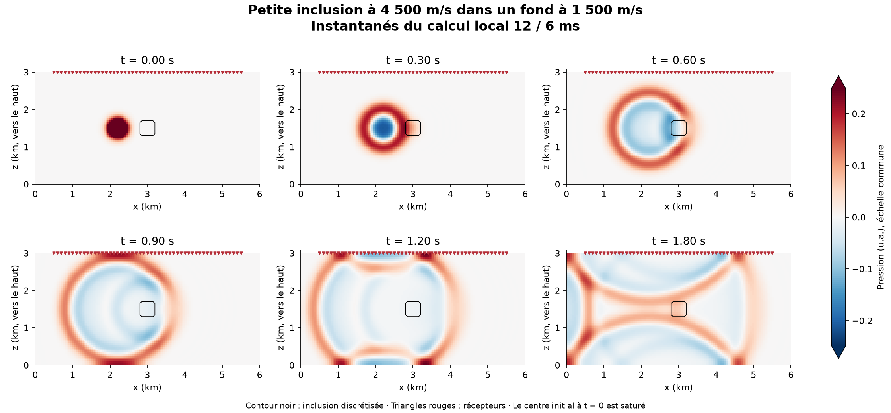
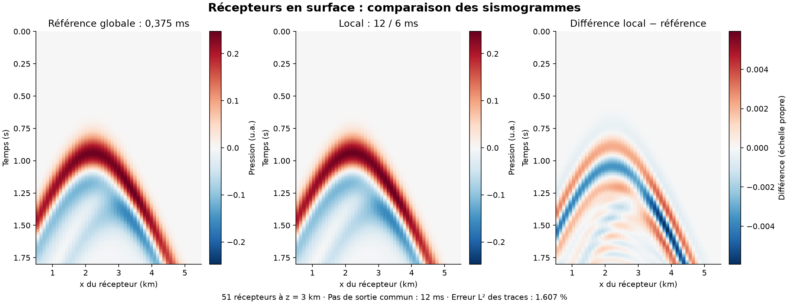
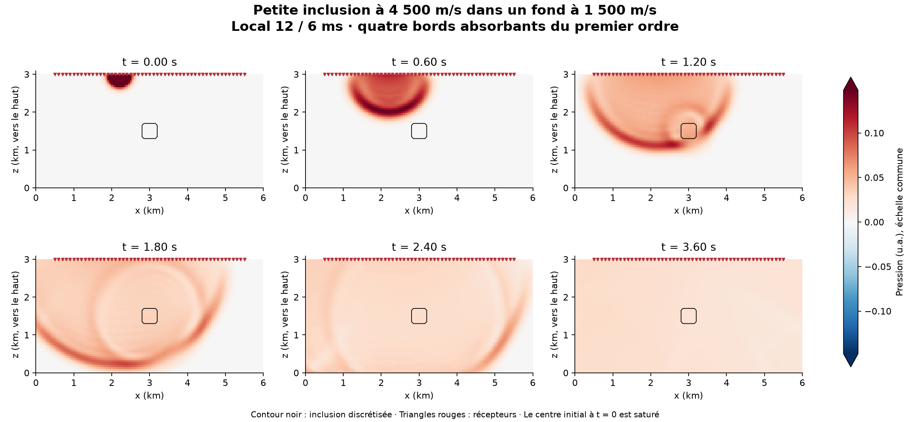
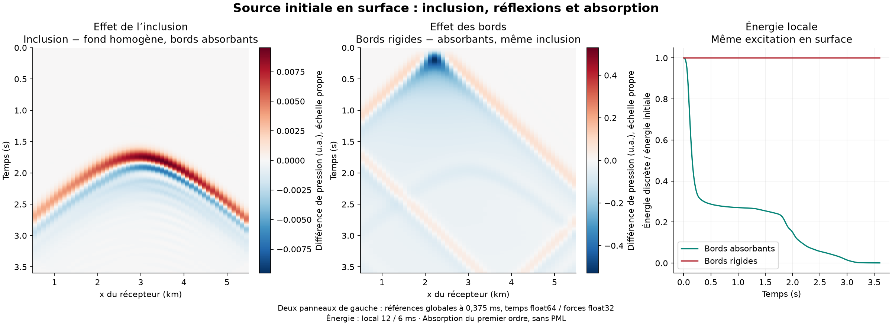

# SEM acoustique 2D à pas de temps local : mathématiques et implémentation

## 1. Objet et état du développement

Ce document décrit le solveur acoustique bidimensionnel par éléments spectraux
(SEM, *spectral element method*) et son intégration locale en temps (LTS,
*local time stepping*). Il relie les équations aux fonctions C++ et décrit le
test d’un fond à 1 500 m/s contenant une inclusion à 4 500 m/s.
État du code et mesures : **7 novembre 2026**.

Le solveur exécuté utilise deux niveaux temporels de rapport **2**, un pas
constant pendant chaque simulation, un modèle acoustique sans source forcée et
un seul processus. L’amortissement de bord diagonal est maintenant pris en charge
(section 12). Plusieurs inclusions peuvent appartenir à
la même zone fine. Des pas cibles indépendants sont conservés dans la définition
du modèle ; leur exécution avec des rapports non entiers reste à développer.

| Objet | État |
|---|---|
| SEM acoustique sur quadrilatères conformes | Implémenté |
| Projection fine et voisinage spatial | Implémentés |
| LF-LTS stabilisé de rapport 2 | Implémenté et testé |
| Plusieurs inclusions dans la définition du modèle | Implémenté, deux inclusions exécutées |
| Pas cibles 12, 4 et 5,5 ms enregistrés séparément | Implémenté dans la préparation et les diagnostics |
| Intégration avec ces trois pas indépendants | Non implémentée |
| Récepteurs et instantanés aux grands pas physiques | Implémentés dans la validation |
| Bords absorbants du premier ordre, amortissement diagonal | Implémentés, bilan de dissipation testé |
| Source temporelle, éponge, adjoint et MPI en LTS | Non pris en charge |

Les développements algébriques ci-dessous explicitent l’opérateur du code.
La famille LF-LTS stabilisée et sa formulation polynomiale sont décrites par
[Grote, Michel et Sauter, section 2.4](https://arxiv.org/html/2005.13350v4#S2.SS4).
Les hypothèses de leurs théorèmes doivent être vérifiées avant de les appliquer
à un modèle hétérogène particulier.

## 2. Équation acoustique et discrétisation spatiale

### 2.1. Variables et conditions aux limites

On note $u(\mathbf{x},t)$ la pression, $c(\mathbf{x})>0$ la vitesse de propagation
et $\rho(\mathbf{x})>0$ la densité. Dans le domaine $\Omega\subset\mathbb{R}^2$,
le problème sans source s’écrit

$$
\frac{1}{\rho c^2}\,\partial_{tt}u
-\nabla\cdot\left(\frac{1}{\rho}\nabla u\right)=0.
\tag{1}
$$

Le test utilise une densité constante normalisée à 1. L’axe $z$ est orienté
vers le haut ; la surface géométrique est le bord supérieur $z=3\,000$ m.
Les bords rigides imposent une condition naturelle
$\mathbf{n}\cdot\rho^{-1}\nabla u=0$, où $\mathbf{n}$ est la normale extérieure.
Une surface à pression nulle impose au contraire $u=0$. Cette seconde condition
n’est pas utilisée pour les récepteurs de pression placés exactement en surface,
car ils y enregistreraient une pression imposée nulle.

Après multiplication par une fonction test $v$ et intégration par parties,
la formulation faible à bords rigides est

$$
\int_\Omega\frac{v\,\partial_{tt}u}{\rho c^2}\,d\Omega
+\int_\Omega\frac{\nabla v\cdot\nabla u}{\rho}\,d\Omega=0.
\tag{2}
$$

### 2.2. Base nodale et quadrature

Sur chaque quadrilatère, la base est le produit tensoriel des polynômes de
Lagrange aux points de Gauss–Lobatto–Legendre (GLL). L’ordre spatial $q$ donne
$(q+1)^2$ points par élément. Le cas présent utilise $q=2$, donc neuf points
locaux par élément. Les nœuds communs à plusieurs éléments sont assemblés dans
un seul degré de liberté global.

En notant $\varphi_i$ les fonctions de base globales, on représente la pression
par $u_h(\mathbf{x},t)=\sum_i U_i(t)\varphi_i(\mathbf{x})$. La quadrature GLL
donne le système semi-discret

$$
M\ddot{\mathbf U}+K\mathbf U=0,
\qquad
M_{ii}=\sum_{e\ni i}\frac{w_{e,i}|J_e(\xi_i)|}{\rho_{e,i}c_{e,i}^2},
\tag{3}
$$

où $w_{e,i}$ est le poids de quadrature tensoriel et $J_e$ le déterminant
du jacobien de l’application géométrique. La matrice de masse $M$ est diagonale
et strictement positive pour les modèles acceptés.

La matrice de raideur, évaluée avec la même quadrature, est

$$
K_{ij}=\sum_e\int_e\frac{1}{\rho}
\nabla\varphi_i\cdot\nabla\varphi_j\,d\Omega.
\tag{4}
$$

Le code applique $K$ sans assembler une matrice creuse globale. Il calcule
les contributions élémentaires par factorisation tensorielle et les ajoute
aux nœuds globaux avec des opérations atomiques. $K$ est symétrique et
semi-définie positive dans le cas rigide. Le champ constant appartient à son
noyau. Les termes de bord disparaissent de (2) pour la condition rigide.

**Conséquence pour l’inclusion.** À densité constante, la vitesse intervient
dans $M$, alors que $K$ dépend de $1/\rho$. Une région plus rapide réduit les
masses locales et peut augmenter les valeurs propres de l’opérateur dynamique,
même si cette région ne contient que quelques éléments.

## 3. Intégration globale et contrainte de stabilité

### 3.1. Leapfrog et normalisation par la masse

Pour un pas global $h$, la récurrence centrée est

$$
\mathbf U^{n+1}=2\mathbf U^n-\mathbf U^{n-1}
-h^2M^{-1}K\mathbf U^n.
\tag{5}
$$

On introduit $\mathbf Y=M^{1/2}\mathbf U$ et la matrice symétrique
$A=M^{-1/2}KM^{-1/2}$. Chaque mode propre de valeur propre $\lambda\geq0$
satisfait alors

$$
y^{n+1}-(2-h^2\lambda)y^n+y^{n-1}=0.
\tag{6}
$$

Pour un mode oscillant, les racines restent de module un lorsque
$0<h^2\lambda<4$. On choisit une marge par rapport à l’extrémité de stabilité :

$$
h<\frac{2}{\sqrt{\lambda_{\max}(A)}}.
\tag{7}
$$

À la frontière $h^2\lambda=4$, une racine double peut produire une croissance
linéaire pour certaines données initiales ; cette frontière n’est donc pas un
choix de production. Le mode constant de valeur propre nulle conserve le
comportement physique affine en temps correspondant à sa vitesse initiale.

### 3.2. Estimation numérique dans le test

La fonction `spectralEstimate()` applique $A$ par trois opérations : division
par $\sqrt M$, application de $K$, puis nouvelle division par $\sqrt M$.
Une itération de puissance à vecteur initial pseudo-aléatoire estime la plus
grande valeur propre. Le quotient de Rayleigh et le résidu relatif enregistrés
sont

$$
\widehat\lambda=\frac{\mathbf x^TA\mathbf x}{\mathbf x^T\mathbf x},
\qquad
\eta=\frac{\|A\mathbf x-\widehat\lambda\mathbf x\|_2}
{\widehat\lambda\|\mathbf x\|_2}.
\tag{8}
$$

Cette procédure donne une estimation numérique, pas une borne supérieure
certifiée de $\lambda_{\max}$. Le résidu mesure la qualité du mode trouvé ; il
ne prouve pas à lui seul que ce mode est le plus élevé. Les itérations sont
plafonnées à 2 500. Le résidu du témoin homogène est d’environ $2,0\,10^{-4}$,
et celui du modèle avec inclusion d’environ $9,5\,10^{-6}$.

| Modèle, même maillage | Limite globale estimée |
|---|---:|
| Homogène, 1 500 m/s | 19,246 ms |
| Inclusion de 400 × 400 m à 4 500 m/s | 6,579 ms |

La limite estimée est divisée par environ **2,93**. L’inclusion impose donc une
contrainte temporelle globale malgré sa surface de seulement 0,89 % du domaine.
Le calcul global à 12 ms reste borné dans le témoin homogène et diverge dans
le modèle avec inclusion pendant la simulation de 1,8 s.

## 4. Partition des zones temporelles

### 4.1. Diagnostic géométrique

Pour chaque élément $e$, le plan calcule le plus petit espacement $s_e$ entre
points GLL adjacents et la vitesse maximale $c_e^{\max}$. À partir d’un
paramètre de sélection $\gamma>0$, nommé `cfl` dans l’API, il définit

$$
\widehat h_e=\gamma\frac{s_e}{c_e^{\max}}.
\tag{9}
$$

Pour un grand pas $H$, l’élément est fin si $\widehat h_e<H$ et grossier sinon.
Le plan exige $H/2\leq\widehat h_e$ pour chaque élément ; il refuse la
configuration si les deux niveaux sont insuffisants. Une tolérance relative
de huit epsilons float32 évite les changements dus à l’arrondi au seuil.

Cette règle sélectionne les zones. Elle ne remplace pas la condition spectrale
(7), ni son analogue pour l’opérateur local. Le choix de `cfl=0.6` dans le test
d’inclusion n’est donc pas présenté comme une constante universelle de stabilité.

Le **maillage spatial est uniforme et ne change pas** : les éléments mesurent
100 × 100 m dans le fond comme dans l’inclusion. À l’ordre 2, leurs nœuds GLL
sont espacés de $s_e=50$ m dans chaque direction. Il n’y a aucun raffinement
spatial autour de l’inclusion.

Seule la vitesse change : 1 500 m/s dans le fond et 4 500 m/s dans l’inclusion.
Pour $H=12$ ms et $\gamma=0,6$, l’estimation temporelle (9) vaut donc 20 ms
dans le fond et 6,667 ms dans l’inclusion. Le fond est classé au niveau temporel
grossier de 12 ms et l’inclusion au niveau temporel fin de 6 ms. Dans ce cas,
« fin » et « grossier » désignent uniquement les **niveaux de temps**, et non
la taille des éléments. Les nœuds d’interface partagés appartiennent aussi
à la zone fine en temps, comme précisé ci-dessous.

### 4.2. Projection nodale et voisinage

On définit $\mathcal F$ comme l’union des nœuds des éléments fins. La projection
diagonale $P$ vaut un sur $\mathcal F$ et zéro ailleurs. Les nœuds d’interface
partagés avec un élément grossier appartiennent à $\mathcal F$.

Le voisinage de support est

$$
\mathcal S=\{e:\operatorname{nodes}(e)\cap\mathcal F\neq\varnothing\}.
\tag{10}
$$

Il comprend les voisins par arête **et par sommet**. Pour un champ $\mathbf v$
porté par $\mathcal F$, on a
$K\mathbf v=\sum_{e\in\mathcal S}K_e\mathbf v$ ; les autres éléments
n’ont aucune valeur nodale d’entrée non nulle. Limiter cette somme aux seuls
éléments fins supprimerait des contributions de raideur des éléments voisins.

Dans le test à une inclusion, $\mathcal F$ est construit à partir de 16 éléments
et $\mathcal S$ contient 36 éléments. Les deux inclusions du cas supplémentaire
donnent 32 éléments fins et 72 éléments de support, leurs voisinages étant
disjoints dans cette géométrie. La construction générale déduplique les nœuds
et les éléments lorsque les voisinages se recouvrent.

## 5. Schéma LF-LTS stabilisé à deux niveaux

### 5.1. Opérateur effectivement appliqué

Le paramètre de stabilisation vérifie $0\leq\nu\leq0{,}5$, avec $\nu=0{,}01$ par défaut.
On définit

$$
\delta=1+\frac{\nu}{4},\qquad
a_\nu=\frac{2\delta^2-1}{16\delta^2},\qquad
B_H=K-a_\nu H^2KPM^{-1}K.
\tag{11}
$$

La récurrence du prototype est

$$
\boxed{\mathbf U^{n+1}=2\mathbf U^n-\mathbf U^{n-1}
-H^2M^{-1}B_H\mathbf U^n.}
\tag{12}
$$

Elle utilise une application complète de $K$, puis une application limitée au
voisinage $\mathcal S$. Les corrections intermédiaires ne constituent pas un
champ physique disponible automatiquement au temps $t_n+H/2$.

### 5.2. Lecture de la correction

Les opérations pour calculer $B_H\mathbf U$ sont

$$
\mathbf r=K\mathbf U,\qquad
\mathbf z=PM^{-1}\mathbf r,\qquad
\mathbf c=K\mathbf z,\qquad
B_H\mathbf U=\mathbf r-a_\nu H^2\mathbf c.
\tag{13}
$$

Le champ $\mathbf z$ est nul hors de la zone fine. Son produit par $K$ peut
donc utiliser uniquement les éléments de support. L’ordre des opérations est
essentiel : $KPM^{-1}K$ ne peut pas être remplacé par un produit dans lequel
la projection est déplacée arbitrairement.

Pour $\nu=0$, $a_0=1/16$. Si toute la zone est fine, la relation scalaire sur
un mode propre est

$$
y^{n+1}=\left(2-H^2\lambda+\frac{H^4\lambda^2}{16}\right)y^n-y^{n-1}.
\tag{14}
$$

Le coefficient de $y^n$ est celui obtenu en éliminant le niveau intermédiaire
de deux récurrences leapfrog de pas $H/2$. Cette identité explique le rapport 2.
Pour une zone fine partielle, l’opérateur assemblé et sa projection assurent
le couplage ; on ne fait pas simplement avancer deux solveurs indépendants.

### 5.3. Démarrage et échange de champs

Avec la pression initiale $\mathbf U^0$ et sa dérivée temporelle
$\mathbf V^0$, le champ précédent est initialisé par

$$
\mathbf U^{-1}=\mathbf U^0-H\mathbf V^0
-\frac{H^2}{2}M^{-1}B_H\mathbf U^0.
\tag{15}
$$

Le même opérateur modifié est donc utilisé au démarrage et pendant la
récurrence. $\mathbf V^0$ est une dérivée temporelle de pression, distincte
de la vitesse acoustique $c$. Le test impose $\mathbf V^0=0$.

Le noyau écrit $\mathbf U^{n+1}$ dans le tampon précédent. Le programme doit
appeler `swapWavefields()` **une fois après chaque grand pas**. Il ne doit pas
échanger les champs immédiatement après `initializePreviousField()`.

## 6. Énergie, stabilité et ordre de précision

### 6.1. Symétrie de l’opérateur

Les matrices $P$ et $M^{-1}$ sont diagonales, donc elles commutent. Par
conséquent, $KPM^{-1}K$ et $B_H$ sont symétriques. L’opérateur normalisé est

$$
\widetilde B_H=M^{-1/2}B_HM^{-1/2}
=A-a_\nu H^2APA.
\tag{16}
$$

Pour la récurrence locale, la condition modale porte sur les valeurs propres
$\mu$ de $\widetilde B_H$ : elles doivent être non négatives et les modes
oscillants doivent vérifier $H^2\mu<4$. Une vitesse maximale et la seule
proportion d’éléments fins ne suffisent pas à vérifier cette condition.

### 6.2. Conservation de l’énergie discrète

On associe aux deux champs stockés l’énergie

$$
E^{n-1/2}=\frac12\left[
\left\|\frac{\mathbf U^n-\mathbf U^{n-1}}{H}\right\|_M^2
+(\mathbf U^{n-1})^TB_H\mathbf U^n\right],
\quad \|\mathbf v\|_M^2=\mathbf v^TM\mathbf v.
\tag{17}
$$

Pour démontrer sa conservation en arithmétique exacte, on soustrait deux
énergies successives. En posant
$\mathbf d_+=\mathbf U^{n+1}-\mathbf U^n$ et
$\mathbf d_-=\mathbf U^n-\mathbf U^{n-1}$, la différence cinétique contient

$$
\mathbf d_+^TM\mathbf d_+-\mathbf d_-^TM\mathbf d_-
=(\mathbf d_+-\mathbf d_-)^TM(\mathbf d_++\mathbf d_-).
\tag{18}
$$

La récurrence donne
$M(\mathbf d_+-\mathbf d_-)=-H^2B_H\mathbf U^n$.
La contribution cinétique à $E^{n+1/2}-E^{n-1/2}$ vaut donc
$-\tfrac12(\mathbf U^{n+1}-\mathbf U^{n-1})^TB_H\mathbf U^n$.
La différence des termes de raideur est son opposée, par symétrie de $B_H$.
On obtient $E^{n+1/2}=E^{n-1/2}$.

Cette conservation ne prouve pas que l’énergie est positive. Pour le voir,
on pose $\mathbf v=(\mathbf U^n-\mathbf U^{n-1})/H$ et
$\mathbf m=(\mathbf U^n+\mathbf U^{n-1})/2$. Alors

$$
E^{n-1/2}=\frac12\mathbf v^T
\left(M-\frac{H^2}{4}B_H\right)\mathbf v
+\frac12\mathbf m^TB_H\mathbf m.
\tag{19}
$$

La positivité, modulo le noyau physique, exige les propriétés spectrales
décrites plus haut. Une énergie indéfinie peut être conservée alors qu’un
champ croît ; le test vérifie donc aussi les champs et leurs erreurs.

### 6.3. Consistance temporelle

Pour une partition fixe et un problème spatial fixé,
$B_H=K+O(H^2)$. Dans (12), la correction est multipliée par $H^2$ ; le défaut
de la récurrence est donc d’ordre $H^4$ pour une solution suffisamment
régulière. Sous les conditions de stabilité appropriées et avec un démarrage
compatible, cela conduit à une précision globale d’ordre 2 en temps.

Pour vérifier cet ordre numériquement, il faut garder la même projection $P$
lorsqu’on réduit $H$. Le benchmark multiplie donc `cfl` par $H/H_0$ avec un
couple de référence $(H_0,\gamma_0)$ ; les comparaisons des listes fines
contrôlent que la partition n’a pas changé.

La conservation observée dans le test d’inclusion à 12 / 6 ms est une dérive
relative maximale d’environ $2,39\,10^{-7}$ sur 1,8 s. C’est une observation
float32 de cette configuration, pas une preuve pour tous les maillages.

## 7. Correspondance avec le code

Les chemins ci-dessous sont relatifs au dossier de ce document.

| Étape mathématique | Implémentation | Rôle |
|---|---|---|
| Diagnostic (9), ensembles fins et support | [`src/sem_2d_local_time_step_plan.cc`](../../../src/solver/impl/sem-local-time-step-2d/src/sem_2d_local_time_step_plan.cc) | Lire géométrie et vitesse sur le device, assembler les listes sur le host |
| Masse et mise à jour globale | [`../sem2d/include/sem_solver_2d.h`](../../../src/solver/impl/sem2d/include/sem_solver_2d.h) | Quadrature, masse diagonale, mise à jour des deux tampons |
| Configuration de $H$, $P$ et $a_\nu H^2$ | [`configureLocalTimeStep()`](../../../src/solver/impl/sem-local-time-step-2d/include/sem_solver_2d_local_time_step.h) | Vérifier les entrées et copier les listes sur le device |
| Application de $K$ | `assembleStiffness()` dans le même fichier | Factorisation tensorielle, projection des nœuds à pression nulle, assemblage atomique |
| Correction (13) | `applyEffectiveStiffness()` | Construire $PM^{-1}K\mathbf U$, appliquer le support, corriger la force |
| Démarrage (15) | `initializePreviousField()` | Construire le niveau $-H$ avec l’opérateur modifié |
| Récurrence (12) | `computeOneStep()` puis `swapWavefields()` | Calculer la force et avancer les deux champs |
| Diagnostic (17) | `discreteEnergy()` | Appliquer $B_H$ et réduire la somme en précision double |
| Plusieurs inclusions | [`validation/prepare_inclusions.py`](../../../tests/validation/sem-local-time-step-2d/prepare_inclusions.py) | Construire la vitesse, la densité, les identifiants et les pas cibles par élément |
| Test et sorties | [`validation/benchmark_inclusions.cc`](../../../tests/validation/sem-local-time-step-2d/benchmark_inclusions.cc) | Références, spectre estimé, mesures répétées, instantanés et traces |
| Tracés et contrôles | [`validation/plot_inclusions.py`](../../../tests/validation/sem-local-time-step-2d/plot_inclusions.py) | Contrôler les CSV et produire les figures |

Le déroulement d’un grand pas peut se résumer ainsi :

```text
r = K(current)                         # tous les éléments
z[fine_nodes] = r[fine_nodes] / mass   # z est nul ailleurs depuis la configuration
r -= a_nu * H^2 * K_support(z)         # inclut les voisins grossiers, métrique précalculée
previous = 2*current - previous - H^2 * r/mass
swap(current, previous)
```

Le solveur valide la dimension, l’ordre, l’emplacement des propriétés, les
masses positives, les tailles des champs et l’absence de recouvrement mémoire
entre entrées et sorties. Il refuse les sources temporelles forcées et l’éponge,
les champs à trois tampons et les données distribuées. Le grand pas fourni
à chaque appel doit être celui de la configuration. Un changement de vitesse,
de géométrie ou de pas impose de reconstruire les opérateurs et la partition.

Les tableaux de travail `fine_acceleration_` et `energy_force_` ont la taille
globale $N$ du champ, soit $2N$ réels en plus des champs de propagation ; s'y
ajoutent un indicateur par élément (contact avec la surface libre) et la
métrique précalculée des éléments du support ($3(p+1)^2$ réels par élément).
Depuis l'étape 1 du plan (9 novembre), un grand pas ne parcourt plus tous les
nœuds que pour le calcul de $K$ et la mise à jour : la projection et la
correction restent locales à la zone fine et à son support. Les instanciations par
ordre et emplacement du modèle sont générées par CMake dans une seule unité
de traduction par couple, afin d’éviter la duplication des noyaux CUDA.

Si $N_e$ est le nombre d’éléments et $N_s$ celui des éléments de support, un
modèle de coût indicatif est

$$
T_{\rm global}\approx\frac{T}{h}
\left(C_KN_e+C_VN\right),\qquad
T_{\rm LTS}\approx\frac{T}{H}
\left[C_K(N_e+N_s)+C'_VN+C_P|\mathcal F|\right].
\tag{20}
$$

Les constantes représentent les coûts d’opérateur, de parcours de vecteurs et
de projection. Elles dépendent du matériel et de l’implémentation. Cette
expression explique les quantités à mesurer ; elle n’est pas une prédiction
calibrée des temps. Quand toute la zone est grossière, la correction est
ignorée, mais les chemins d’application de $K$ peuvent encore avoir des coûts
différents de ceux du solveur global de référence.

## 8. Protocole du test avec petites inclusions

### 8.1. Modèle et excitation

La configuration source est
[`validation/inclusion_models.json`](../../../tests/validation/sem-local-time-step-2d/inclusion_models.json).
Le domaine de 6 000 × 3 000 m contient 60 × 30 éléments carrés de 100 m,
soit 1 800 éléments et 7 381 nœuds GLL à l’ordre 2.

Dans le premier modèle hétérogène, le carré
$[2800,3200]\times[1300,1700]$ m a une vitesse de 4 500 m/s.
Le fond est à 1 500 m/s. Le carré couvre 16 éléments, soit 0,89 % du maillage.
Le modèle témoin retire le carré sans changer le maillage ni l’excitation.

Le champ initial est

$$
u(x,z,0)=\exp\left[-\frac{(x-2200)^2+(z-1500)^2}{2(160)^2}\right],
\qquad \partial_tu(x,z,0)=0.
\tag{21}
$$

Il s’agit d’une impulsion initiale de pression, pas d’une source de Ricker
injectée pendant le calcul. L’amplitude est normalisée, en unités arbitraires.
L’onde interagit avec le carré puis atteint le bord supérieur et les autres
bords rigides. Leurs réflexions font partie de la simulation.

Le cas à deux inclusions conserve ce carré et ajoute un disque de centre
$(4100,1900)$ m, de rayon 220 m et de vitesse 3 600 m/s. Les propriétés sont
affectées d’après le centre des éléments ; le disque est donc discrétisé en
16 éléments. Les chevauchements d’inclusions sont refusés et une région sans
élément déclenche une erreur de préparation.

### 8.2. Référence et métriques

La référence utilise le même opérateur spatial avec un pas global de
0,375 ms ; une seconde référence à 0,75 ms contrôle son raffinement.
Dans le modèle à une inclusion, leur écart final est de **0,0201 %**.
L’erreur finale est

$$
\varepsilon_U(T)=
\sqrt{\frac{\sum_iM_{ii}\left(U_i(T)-U_i^{\rm ref}(T)\right)^2}
{\sum_iM_{ii}\left(U_i^{\rm ref}(T)\right)^2}}.
\tag{22}
$$

Cette métrique compare l’intégration temporelle à spatial fixé. Elle ne mesure
pas l’erreur spatiale face à la solution continue. La série `history.csv`
donne aussi l’erreur aux grands pas de sortie, l’énergie locale et l’amplitude
du global à 12 ms.

Les mesures de coût utilisent Kokkos Serial, une compilation GCC 12.3 Release
et un Intel Core i9-13900HX, avec affinité sur le processeur logique 0.
Chaque configuration est échauffée deux fois puis exécutée sept fois, dans un
ordre mélangé. Initialisation, diagnostics, copies vers le host et écritures
sont exclus de la boucle chronométrée et la préparation est enregistrée
séparément. La machine n’est pas réservée et la fréquence n’est pas imposée.

### 8.3. Mesures sur le modèle à une inclusion

| Intégration | Pas | Erreur finale | Boucle médiane |
|---|---|---:|---:|
| Global | 6 ms | 0,521 % | 76,45 ms |
| Local | 8 / 4 ms | 0,924 % | 66,92 ms |
| Local | 10 / 5 ms | 1,445 % | 53,37 ms |
| Local | 12 / 6 ms | 2,081 % | 44,04 ms |

Pour un plafond d’erreur finale de 2 %, les choix de cette grille sont le
global à 6 ms et le local à 10 / 5 ms. Le temps de boucle local est réduit
d’environ **30,2 %** pour ces deux choix. Les erreurs réalisées diffèrent et
les pas n’ont pas été optimisés continûment. En particulier, la limite
spectrale estimée suggère qu’un pas global entre 6 et 6,58 ms mérite également
d’être mesuré avant de conclure sur un gain optimal.

Le calcul local à 12 / 6 ms est celui des figures de propagation et de
récepteurs. Son erreur finale de 2,081 % **dépasse légèrement le budget de
2 %** : il ne doit pas être présenté comme le candidat de la ligne précédente.
Le calcul global à 12 ms dépasse une amplitude de $10^5$, puis produit des
valeurs non finies ; ces configurations sont exclues des comparaisons de coût
sous contrainte d’erreur.

Les résultats ne contredisent pas les essais précédents à couches : un
contraste de vitesse localisé plus fort modifie ici le rapport entre le pas
global admissible et le grand pas local. Le gain dépend du modèle, du pas et
du budget de précision.

## 9. Instantanés et récepteurs en surface

### 9.1. Échantillonnage à des temps physiques communs

Les instantanés sont exportés à 0, 0,3, 0,6, 0,9, 1,2 et 1,8 s.
À chaque grand pas local de 12 ms, la référence effectue 32 pas de 0,375 ms.
Les deux champs sont donc comparés au même temps physique. Aucune
interpolation temporelle n’est utilisée dans ces figures.

La figure suivante montre les champs locaux. Le contour noir repère la région
rapide discrétisée, les triangles rouges les positions des récepteurs. L’échelle
de pression est commune ; le maximum initial est saturé comme indiqué dans la
légende. Le passage dans l’inclusion déforme le front visible vers 0,6 s.
Les images tardives montrent aussi les réflexions des bords rigides.



### 9.2. Traces de pression

Les 51 récepteurs sont aux positions
$x_j=500+100j$ m, $z_j=3\,000$ m, pour $j=0,\ldots,50$.
Ils coïncident avec des nœuds du maillage ; leur mesure est donc l’extraction
directe d’une pression nodale. Le pas de sortie commun est 12 ms.

En notant $D_{kj}$ les traces aux temps $t_k$, la métrique utilisée est

$$
\varepsilon_D=
\sqrt{\frac{\sum_{k,j}(D_{kj}-D^{\rm ref}_{kj})^2}
{\sum_{k,j}(D^{\rm ref}_{kj})^2}}.
\tag{23}
$$

Le pas de sortie uniforme et commun se simplifie dans ce rapport. Pour des
temps non uniformes, il faudra introduire des poids de quadrature temporelle
et comparer les traces à des dates physiques communes. Ici,
$\varepsilon_D=1,607$ % pour le local à 12 / 6 ms. Cette erreur de traces
n’est pas l’erreur du champ final donnée par (22).

La figure des sismogrammes utilise une même échelle pour le global de référence
et le local. La différence possède une échelle propre explicitement indiquée.



Les [quatre traces individuelles](inclusion-results/single_4500/04_traces_surface.png)
conservent les amplitudes originales. Le
[modèle avec acquisition](inclusion-results/single_4500/01_modele_et_recepteurs.png)
et la [comparaison de stabilité](inclusion-results/single_4500/05_precision_et_stabilite.png)
complètent ces vues.

## 10. Généralisation à plusieurs inclusions et à des pas non multiples

### 10.1. Séparer géométrie, diagnostic et intégration

La description géométrique ne doit pas imposer l’algorithme temporel. Chaque
inclusion possède un identifiant, une forme, des dimensions, une vitesse,
une densité et un `target_dt_s` réel positif. La préparation produit par
élément le quintuplet

$$
(e,\;c_e,\;\rho_e,\;\operatorname{region}_e,\;h_e^{\rm cible}).
\tag{24}
$$

Le format est déjà implémenté dans `model.csv`. Les pas cibles sont conservés
sans arrondi vers un rapport entier. L’exemple à deux inclusions contient
12 ms pour le fond, 4 ms pour le carré et 5,5 ms pour le disque. Les rapports
$12/5,5$ et $5,5/4$ ne sont pas entiers.

Le benchmark actuel **n’exécute pas ces trois pas cibles**. Il les lit comme
métadonnées et construit sa partition à partir de la vitesse et de (9).
Dans l’exécution illustrée, les deux inclusions utilisent le même petit pas
de niveau de 6 ms. Les fichiers JSON portent le champ explicite
`target_steps_are_executed: false`.

### 10.2. Plusieurs inclusions dans le schéma actuel

Pour des régions fines disjointes, $P$ est simplement la projection sur leur
union. L’équation (11) reste applicable. Il faut assembler une seule masse
globale, dédupliquer les listes et calculer le support de cette union. Un
nœud partagé n’a pas une masse ou une pression différente par inclusion.

Attribuer à chaque inclusion un solveur isolé, puis copier les pressions
entre solveurs, ne reproduirait pas l’opérateur assemblé (3). La validation
doit notamment faire traverser à l’onde plusieurs interfaces et vérifier le
cas de deux inclusions dont les voisinages se touchent.

### 10.3. Rapports entiers et pas réellement indépendants

Passer du rapport 2 à un rapport entier $r$ demande un polynôme d’ordre adapté
ou une récurrence locale correspondante, ainsi que son démarrage et ses
conditions de stabilité. Changer seulement `fine_dt = H / r` dans le plan
ne change pas (11), qui reste une formule de rapport 2.

Des niveaux entiers supplémentaires pourraient répondre au contraste 3 entre
1 500 et 4 500 m/s, mais ne répondraient pas à l’exigence générale de pas
indépendants. Une hiérarchie de puissances de deux ou un plus petit pas commun
arrondi obligerait aussi à modifier les cibles demandées.

Une piste distincte consiste à utiliser un intégrateur variationnel asynchrone.
Ces méthodes ont été proposées pour des pas élémentaires sans relation entière
imposée ; leur application au SEM acoustique présent exigerait une dérivation
et une validation spécifiques. Cette propriété de la famille AVI est documentée
par [Lew, Marsden, Ortiz et West (2003)](https://authors.library.caltech.edu/records/87fjr-qhc90).

### 10.4. Architecture proposée pour l’extension

L’architecture suivante est une **spécification de développement**, pas le
comportement du solveur livré. Elle évite d’inscrire l’hypothèse de rapports
entiers dans la définition du modèle :

```text
MaterialRegion
  geometry, vp, rho, target_dt

LocalStepDiagnostics
  node_spacing, spectral_or_geometric_indicator, selected_dt

LocalTimeSchedule
  next_event_time[element], local_step[element], event_index[element]

CouplingOperator
  assembled_mass, element_stiffness, shared_node_impulses

ObservationSchedule
  requested_times, spatial_weights, reconstruction_rule
```

Le temps du prochain événement doit être calculé depuis un compteur et une
origine, plutôt que par l’accumulation répétée d’un nombre flottant. Pour des
pas variables, on conserve une horloge et une séquence de dates explicites.
Les égalités de dates sont traitées avec une tolérance documentée, sans
convertir les pas physiques en multiples d’un pas commun.

Une file de priorité fournit le prochain élément ou groupe d’éléments à
traiter. Elle doit inclure les événements d’observation et la fin du calcul.
Regrouper des événements sur GPU pourra réduire le nombre de lancements,
mais toute modification de leur date devra entrer dans l’erreur temporelle
et être contrôlée.

### 10.5. Échanges et énergie : problème mathématique à résoudre

Le système spatial possède l’énergie hamiltonienne

$$
\mathcal H(\mathbf U,\mathbf p)=
\frac12\mathbf p^TM^{-1}\mathbf p
+\sum_e\frac12\mathbf U_e^TK_e\mathbf U_e,
\qquad \mathbf p=M\dot{\mathbf U}.
\tag{25}
$$

Cette écriture fournit une décomposition par contributions de potentiel
élémentaires et une masse assemblée unique. Une mise à jour locale devrait
comptabiliser une contribution $K_e\mathbf U_e$ une seule fois, puis distribuer
l’impulsion correspondante aux nœuds globaux de l’élément.

Deux opérations utiles pour dériver un candidat sont le déplacement libre
et l’impulsion élémentaire :

$$
\begin{aligned}
\mathbf U&\leftarrow\mathbf U+\tau M^{-1}\mathbf p,\\
\mathbf p&\leftarrow\mathbf p-h_e R_e^TK_eR_e\mathbf U,
\end{aligned}
\tag{26}
$$

où $\tau$ est un intervalle d’évolution, $h_e$ un poids temporel et $R_e$
l’opérateur qui extrait les nœuds de l’élément $e$. L’addition dans les nœuds
partagés appartient au même champ de quantité de mouvement $\mathbf p$.

**L’équation (26) ne définit pas encore un intégrateur asynchrone validé.**
L’ordre des opérations, les dates d’application des impulsions, les demi-pas
initiaux et finaux et la règle de reconstruction doivent être dérivés ensemble.
Les choisir arbitrairement pourrait modifier l’ordre de précision, la stabilité
et les propriétés énergétiques. La conservation exacte de (17) ne se transfère
pas automatiquement à une méthode à pas variables ou non multiples.

Pour les sorties, tous les récepteurs doivent mesurer le même état physique
à une date demandée. Il faut soit rendre les événements d’observation compatibles
avec la méthode variationnelle retenue, soit reconstruire un état avec un ordre
connu à partir des histoires locales. Un simple prélèvement du dernier état
connu de chaque nœud mélangerait des dates différentes.

### 10.6. Critères avant activation de la nouvelle méthode

L’extension devra retrouver le SEM global quand tous les pas sont égaux,
traiter plusieurs inclusions aux pas 4 et 5,5 ms sans arrondi et conserver un
couplage unique aux nœuds partagés. Les tests devront aussi utiliser un rapport
tel que $h_2/h_1=\sqrt2$ pour éviter de dépendre implicitement d’un plus petit
pas commun entier.

L’ordre temporel devra être mesuré en multipliant **tous** les pas par le même
facteur, à géométrie et partition fixées. Il faudra contrôler l’énergie physique
(25), une éventuelle énergie discrète propre au nouveau schéma, les traces aux
dates communes, les transitoires de démarrage et des simulations longues. Les
cas d’inclusions proches, de voisinages partagés et de changements de pas sont
nécessaires avant une exposition dans la fabrique ou les interfaces Python.

## 11. Vérifications et limites

### 11.1. Reproduction

Depuis la racine du worktree `FUnTiDES-sem-local-timesetp-2d/`, avec la
configuration CPU du [README](../../../src/solver/impl/sem-local-time-step-2d/README.md), les commandes sont :

```bash
cmake --build build-lts-cpu --target sem2d_lts_inclusion_benchmark -j 4
../FUnTiDES-install/tpl-venv/bin/python \
  tests/validation/sem-local-time-step-2d/prepare_inclusions.py
env -u LD_LIBRARY_PATH taskset -c 0 \
  build-lts-cpu/tests/validation/sem-local-time-step-2d/sem2d_lts_inclusion_benchmark \
  documentation/acoustic/local-time-step/inclusion-results/single_4500 7
../FUnTiDES-install/tpl-venv/bin/python \
  tests/validation/sem-local-time-step-2d/plot_inclusions.py \
  --results documentation/acoustic/local-time-step/inclusion-results/single_4500
```

Les deux dernières commandes peuvent être répétées pour `homogeneous_1500`
et `multiple_noninteger_targets`. Elles remplacent les fichiers de leur cas.
Le script Python réalise les tracés ; les champs, traces et chronométrages
proviennent du calcul C++.

La suite de régression existante s’exécute ainsi :

```bash
env -u LD_LIBRARY_PATH ctest --test-dir build-lts-cpu \
  -R 'SEM2DLocalTimeStepPlan|SEM2DLTS|SemSolver2DTest' --output-on-failure
```

### 11.2. Données et contrôles

Les modèles, paramètres, références spectrales estimées et mesures brutes sont
dans [`inclusion-results/`](inclusion-results/).
`snapshots.csv` contient les champs nodaux ; `receivers.csv` les pressions et
coordonnées de chaque récepteur ; `history.csv` les diagnostics à chaque sortie.
Les résultats non finis restent visibles dans les mesures et ne sont pas
remplacés par des valeurs bornées.

Le script de tracé contrôle le nombre de nœuds et de dates, la position des
récepteurs, les pas cibles conservés, la finitude des champs locaux et de
référence, les comptes de régions et les médianes et quartiles chronométrés.
Le binaire refuse un écart entre références supérieur à 0,1 % et une dérive
relative d’énergie locale supérieure à $10^{-4}$ dans le calcul de diagnostic.

Les 74 tests préexistants couvrent la partition, les opérateurs spatiaux, les
voisins par sommet, la réduction au global, les récurrences indépendantes,
les conditions de surface, l’énergie et la convergence temporelle. La validation
d’inclusion complète cette couverture avec une géométrie rapide de petite
surface et une observation en surface.

### 11.3. Portée

Les mesures concernent une acoustique linéaire 2D, l’ordre 2, des champs
float32, un maillage cartésien et des bords rigides. La référence utilise le même
maillage et ne valide pas l’erreur spatiale. Les dérives d’énergie observées
et les estimations spectrales n’établissent pas une stabilité universelle.
L’implémentation CPU de validation ne démontre pas un gain sur GPU.
Les pas cibles non multiples sont préparés et documentés, mais leur méthode
d’intégration reste une extension de recherche.

## 12. Extension : excitation en surface et bords absorbants

Cette section conserve la campagne aux quatre bords absorbants. Pour la
configuration courante, le bord supérieur est remplacé par une **surface libre**,
comme décrit en section 13. Les chiffres des deux campagnes ne sont pas mélangés.

### 12.1. Condition de bord et matrice de dissipation

Le nouvel essai déplace le centre de la même gaussienne initiale à
`(2200, 3000)` m, exactement sur le bord supérieur. Il ne remplace pas cette
excitation initiale par une source temporelle forcée. Les quatre bords portent
la condition absorbante du premier ordre

$$
\partial_n u+\frac{1}{c}\partial_tu=0.
\tag{27}
$$

Cette condition annule la réflexion d’une onde plane à incidence normale dans
le milieu homogène continu ; elle n’est pas une couche parfaitement adaptée
(PML). Des réflexions résiduelles à incidence oblique, aux coins et dues à la
discrétisation peuvent subsister.

En l’introduisant dans l’intégration par parties de (2), on obtient

$$
M\ddot{\mathbf U}+D\dot{\mathbf U}+K\mathbf U=0,
\qquad
D_{ii}=\sum_{b\ni i}\frac{w_{b,i}|J_b|}{\rho_{b,i}c_{b,i}}\geq0.
\tag{28}
$$

La somme porte sur les arêtes de bord absorbantes incidentes au nœud ; les deux
arêtes d’un coin contribuent. La quadrature nodale donne une matrice $D$
diagonale. Le code réutilise `SEMsolver2D::computeDampingMatrix()`, qui applique
le poids d’arête et la longueur physique divisée par deux sur l’intervalle
de référence. Les masses doivent rester strictement positives, et les coefficients
de dissipation finis et non négatifs.

### 12.2. Récurrence locale avec dissipation

On conserve l’opérateur $B_H$ de (11), et on centre la dérivée amortie :

$$
M\frac{\mathbf U^{n+1}-2\mathbf U^n+\mathbf U^{n-1}}{H^2}
+D\frac{\mathbf U^{n+1}-\mathbf U^{n-1}}{2H}
+B_H\mathbf U^n=0.
\tag{29}
$$

La mise à jour s’écrit donc

$$
\left(M+\frac H2D\right)\mathbf U^{n+1}
=2M\mathbf U^n-\left(M-\frac H2D\right)\mathbf U^{n-1}
-H^2B_H\mathbf U^n.
\tag{30}
$$

Le membre de gauche est diagonal et positif : il ne nécessite qu’une division
par nœud. Le noyau de mise à jour du solveur global effectue déjà cette
opération ; le solveur local lui fournit la force modifiée $B_H\mathbf U^n$.
L’amortissement n’est pas lui-même sous-cyclé dans le polynôme LF-LTS. Pour
un maillage fixé, (29) est une discrétisation centrée d’ordre 2 du problème
amorti, avec $B_H=K+O(H^2)$, sous les conditions de stabilité appropriées.

Le développement de Taylor du champ précédent devient

$$
\mathbf U^{-1}=\mathbf U^0-H\mathbf V^0
-\frac{H^2}{2}M^{-1}(B_H\mathbf U^0+D\mathbf V^0).
\tag{31}
$$

Le terme supplémentaire a été ajouté à `initializePreviousField()`. Il est
nul pour les expériences présentes, où $\mathbf V^0=0$, mais nécessaire pour
une vitesse initiale générale.

### 12.3. Bilan énergétique discret

L’énergie (17) n’est plus constante. En multipliant (29) par
$(\mathbf U^{n+1}-\mathbf U^{n-1})/2$, les termes de masse et de raideur
donnent la même différence d’énergie que dans la démonstration de (18).
Le terme de bord donne exactement

$$
E^{n+1/2}-E^{n-1/2}
=-H\,\widehat{\mathbf V}_n^TD\widehat{\mathbf V}_n\leq0,
\qquad
\widehat{\mathbf V}_n=\frac{\mathbf U^{n+1}-\mathbf U^{n-1}}{2H}.
\tag{32}
$$

On cumule donc la perte
$L_n=\sum_{j=0}^{n-1}H\widehat{\mathbf V}_j^TD\widehat{\mathbf V}_j$
et on vérifie $E^{n-1/2}+L_n=E^{-1/2}$ à l’arrondi près. Contrôler seulement
une dérive par rapport à l’énergie initiale serait incorrect avec ces bords :
sa décroissance est précisément le comportement attendu.

La positivité reste conditionnée par les propriétés spectrales de $B_H$
et de $M-H^2B_H/4$. Si celles-ci sont satisfaites, $D\geq0$ apporte une
dissipation et le bilan (32) contrôle l’évolution. Il ne permet pas d’utiliser
arbitrairement un pas qui viole la stabilité de l’opérateur local.

### 12.4. Vérifications de l’extension

Huit nouveaux tests, aux ordres 1 et 2 avec propriétés nodales et élémentaires,
vérifient le démarrage amorti avec une vitesse initiale non nulle, la réduction
au solveur global lorsque la zone fine est vide, puis la décroissance d’énergie
et le bilan (32) pendant 500 pas sur un maillage à deux niveaux. La suite
de régression contient maintenant **82 tests réussis**.

Les cas d’essai et les résultats sont séparés de la première campagne :
[`validation/inclusion_surface_absorbing.json`](../../../tests/validation/sem-local-time-step-2d/inclusion_surface_absorbing.json)
et [`surface-absorbing-results/`](surface-absorbing-results/).
Ils comprennent un témoin homogène absorbant, une inclusion absorbante,
deux inclusions absorbantes et la même inclusion avec source en surface et
bords rigides. La durée est portée de 1,8 à **3,6 s** pour observer le retour
des ondes vers les récepteurs en surface. La position des 51 récepteurs reste
inchangée.

Les instantanés sont pris à 0, 0,6, 1,2, 1,8, 2,4 et 3,6 s. Le fichier
`history.csv` contient désormais aussi la dissipation cumulée et le défaut
du bilan énergétique. Les observations des campagnes rigides précédentes
restent celles des sections 8 et 9 ; elles ne sont pas remplacées par les
mesures de cette extension.

### 12.5. Précision de la référence à faible énergie résiduelle

La simulation absorbe presque toute l’énergie initiale. Le résidu de champ
final est donc plus sensible à l’arrondi que dans le cas rigide. Le premier
contrôle, effectué avec la récurrence globale entièrement en float32, a donné
un écart final de 1,154 % entre les pas de 0,75 et 0,375 ms ; il a été refusé
par le contrôle de précision de la référence.

Pour cette nouvelle campagne, les deux tampons de la **récurrence temporelle
de référence** sont conservés en float64, y compris au démarrage de Taylor.
L’opérateur spatial, les masses et les coefficients de bord restent ceux du
solveur float32 ; le champ est converti en float32 pour chaque application
de la force spatiale. Il s’agit donc d’une référence à précision mixte, et non
d’un solveur spatial entièrement en double précision. Les solveurs dont les
temps sont comparés continuent à utiliser leur récurrence float32 normale.

Avec cette référence, l’écart de raffinement descend à **0,00584 %** dans le
cas à une inclusion et bords absorbants. Le paramètre
`reference_time_accumulation` et le champ de protocole
`reference_double_time_accumulation` enregistrent ce choix. Les références
des figures et celles des calculs d’erreur utilisent la même précision mixte.

Le défaut du bilan local (32) reste inférieur à $2,1\,10^{-7}$ de l’énergie
initiale. À 3,6 s, la fraction d’énergie discrète restante est de
**0,0825 %**, et la fraction dissipée de **99,9175 %**. Ces valeurs décrivent
le cas testé, avec absorption du premier ordre sur les quatre côtés et
excitation initiale en surface.

### 12.6. Traces, réponse différentielle et coût

Pour le local à 12 / 6 ms, l’erreur relative finale du champ est de **0,989 %**
et l’erreur maximale aux dates de sortie de **1,981 %**. L’erreur sur les
traces complètes en surface est de **0,435 %**. Cette dernière métrique inclut
l’impulsion initiale et le signal direct, plus forts que les retours de
l’inclusion.

Pour isoler la réponse différentielle de l’inclusion, on définit
$\Delta D=D_{\rm inclusion}-D_{\rm homogène}$ avec la même excitation et les
mêmes bords absorbants, puis on compare $\Delta D_{\rm LTS}$ à
$\Delta D_{\rm ref}$. L’erreur relative
$\|\Delta D_{\rm LTS}-\Delta D_{\rm ref}\|_F/\|\Delta D_{\rm ref}\|_F$
vaut **8,94 %** sur l’ensemble des traces. La précision de cette réponse faible
est donc moins bonne que ne le suggère la métrique des traces complètes.





Dans la figure précédente, la différence entre bords rigides et absorbants
regroupe aussi le changement de rayonnement près de l’excitation située sur
le bord. Elle ne doit pas être assimilée à une mesure isolée du coefficient
de réflexion. Les [traces différentielles individuelles](surface-absorbing-results/07_reponse_differentielle_inclusion.png)
conservent leurs amplitudes.

Pour un plafond de **1 % sur le champ final**, les configurations retenues
dans la grille testée sont le global à 6 ms (erreur 0,460 %, boucle médiane
151,52 ms) et le local à 12 / 6 ms (erreur 0,989 %, boucle médiane 89,51 ms).
La réduction de temps est de **40,9 % pour ces pas choisis**, sans optimisation
continue des pas. Ce plafond ne porte ni sur toute la trajectoire ni sur
la réponse différentielle de l’inclusion.

Une composante de pression quasi constante peut subsister après le départ
des ondes. Les conditions absorbantes (27) admettent un état constant
stationnaire, dont l’énergie de gradient est nulle. L’impulsion initiale
positive n’a pas une moyenne nulle ; une faible énergie dynamique restante
n’implique donc pas une pression identiquement nulle.

Les [résultats détaillés et commandes de reproduction](surface-absorbing-results/README-quatre-bords-absorbants.md)
décrivent les quatre cas, les 728 chronométrages, la précision de référence
et les contrôles du bilan d’énergie.

## 13. Configuration courante : surface libre, côtés et fond absorbants

Le sommet $z=Z_s=3000$ m impose désormais **$u(x,Z_s,t)=0$**. Les côtés et
le fond gardent la condition absorbante (27). Aux coins supérieurs, la
condition de pression nulle a priorité ; le terme de dissipation est donc nul
sur ces degrés de liberté contraints. Le maillage spatial et l’inclusion
restent inchangés.

Une excitation de pression placée exactement sur cette surface serait annulée.
Le centre de la gaussienne est donc situé à $(x_s,z_s)=(2200,2800)$ m, soit
**200 m sous la surface**. Les récepteurs de pression sont à $z=2950$ m, soit
**50 m sous la surface**, sur la première rangée GLL intérieure. Les laisser
exactement au sommet produirait des traces identiquement nulles.

Pour respecter la condition de pression dès l’état initial sans tronquer
brutalement une gaussienne, on utilise une image de signe opposé, de centre
symétrique $z_s^*=2Z_s-z_s=3200$ m :

$$
u_0(x,z)=\exp\left[-\frac{(x-x_s)^2}{2\sigma^2}\right]
\left\{\exp\left[-\frac{(z-z_s)^2}{2\sigma^2}\right]
-\exp\left[-\frac{(z-z_s^*)^2}{2\sigma^2}\right]\right\},
\qquad \sigma=160\;\mathrm m.
\tag{33}
$$

Les deux termes s’annulent exactement à $z=Z_s$. La dérivée temporelle initiale
reste nulle. Il s’agit toujours d’une condition initiale de pression et non
d’un forçage temporel. La pression est projetée à zéro à chaque pas, y compris
dans les deux tampons float64 de la référence à précision mixte.

La configuration est définie dans
[`validation/inclusion_free_surface.json`](../../../tests/validation/sem-local-time-step-2d/inclusion_free_surface.json).
Les modes de bord sont distincts dans le benchmark : rigide, quatre côtés
absorbants, sommet libre avec côtés/fond absorbants, et sommet libre avec
côtés/fond rigides. La profondeur des récepteurs est enregistrée explicitement.
La préparation refuse une excitation ou des récepteurs de pression sur le
sommet libre ; les profondeurs d’enregistrement doivent coïncider avec une
rangée GLL.

Quatre tests supplémentaires, aux ordres 1 et 2 avec propriétés nodales et
élémentaires, combinent surface libre, côtés absorbants et deux niveaux
temporels. Ils vérifient la pression nulle au sommet, la décroissance d’énergie
et le bilan de dissipation pendant 300 pas. Les **86 tests de régression passent**.
Le calcul de validation contrôle aussi, à chaque sortie, la pression au sommet
pour le local et la référence : son maximum mesuré est exactement nul.

Le cas à une inclusion a été relancé pendant **3,6 s**, avec sept mesures
par configuration et une référence à 0,375 ms. Les
[temps de calcul demandés](free-surface-results/README.md) et leur
[tableau CSV](free-surface-results/compute_times.csv) portent uniquement
sur la boucle de propagation, hors initialisation, diagnostics, copies host
et écritures. La comparaison retenue est le global à 6 ms et le local
à 12 / 6 ms ; les pas sont explicités sans affirmer une précision identique.
Les configurations homogène, à deux inclusions et à côtés rigides sont préparées
dans le fichier d’entrée, mais seuls les résultats exécutés du cas à une
inclusion sont présentés dans cette campagne.

### Affichage des sismogrammes avec gain commun

Pour éviter que l’impulsion initiale proche des récepteurs domine les cartes,
un gain d’affichage $g(t)=\min[(t/(1\;\mathrm s))^2,20]$ est appliqué aux
traces. Les trois panneaux montrent respectivement $g(t)D_{\rm ref}$,
$g(t)D_{\rm LTS}$ et $g(t)(D_{\rm LTS}-D_{\rm ref})$. Ils partagent une
unique échelle de couleurs symétrique, déterminée par le maximum absolu de
la référence après gain. L’erreur n’a donc aucune amplification ni normalisation
indépendante. Il n’y a pas de normalisation trace par trace.

Ce gain est nul à $t=0$, vaut 1 à 1 s et 12,96 à 3,6 s ; la borne de 20
n’est pas atteinte pendant ce calcul. Les traces individuelles emploient le
même gain et superposent aussi la différence sur les mêmes axes. Les champs,
CSV, métriques d’erreur et temps de calcul ne sont pas modifiés. Le fichier
`display_gain.json` enregistre la formule et les bornes de l’échelle commune.

Les paramètres du script de tracé sont `--gain-power 2`,
`--gain-reference-time 1` (seconde) et `--gain-max 20`.

## 14. Références

1. M. J. Grote, S. Michel et S. A. Sauter, *Stabilized leapfrog based local
   time-stepping method for the wave equation*, arXiv:2005.13350v4, 2022,
   [section 2.4](https://arxiv.org/html/2005.13350v4#S2.SS4).
   Référence de la famille LF-LTS stabilisée ; le présent document explicite
   le cas de rapport 2 effectivement codé.
2. A. Lew, J. E. Marsden, M. Ortiz et M. West, *Asynchronous Variational
   Integrators*, Archive for Rational Mechanics and Analysis, 167, 85–146,
   2003, DOI [10.1007/s00205-002-0212-y](https://doi.org/10.1007/s00205-002-0212-y),
   [notice et manuscrit auteur](https://authors.library.caltech.edu/records/87fjr-qhc90).
   Piste bibliographique pour l’extension à des pas indépendants, non exécutée ici.
3. [Solveur local et contrats d’API](../../../src/solver/impl/sem-local-time-step-2d/include/sem_solver_2d_local_time_step.h),
   [construction de la partition](../../../src/solver/impl/sem-local-time-step-2d/src/sem_2d_local_time_step_plan.cc),
   [benchmark des inclusions](../../../tests/validation/sem-local-time-step-2d/benchmark_inclusions.cc) : sources
   de l’implémentation et des mesures décrites.
4. [Étude précédente à proportions fines variables](fraction-results/README.md) :
   protocole des couches, raffinement des pas et limites des comparaisons.
