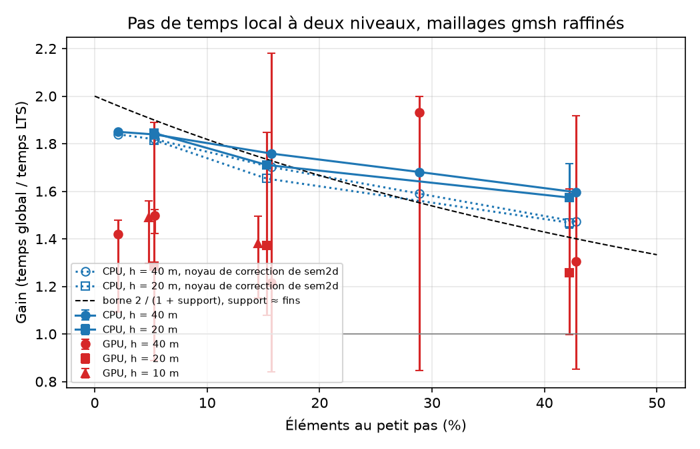

# Domaine de rentabilité du pas de temps local, CPU et GPU (étape 2 du plan)

Étude du 9 novembre 2026. Elle mesure le gain du pas de temps local à deux niveaux sur des
maillages gmsh raffinés géométriquement, en fonction de la proportion d'éléments au petit
pas, le calcul global prenant le pas imposé par sa stabilité.



## Cas

Milieu homogène (2 000 m/s), domaine 6 000 × 3 000 m, surface libre en haut et bords
absorbants, ordre 2. Quadrangles non structurés (frontal-Delaunay pour quadrangles et
recombinaison blossom) de taille h, avec un carré central de côté 200 à 1 600 m à h/2
et une transition de 200 m (`generate_gmsh_fine_fraction.py`). Trois tailles :
h = 40 m (11 000 à 17 000 éléments), 20 m (45 000 à 68 000), 10 m (180 000 à 270 000).
Les maillages ne sont pas versionnés ; `cases/<cas>/case.json` et `spectral.json` en gardent
les paramètres et l'estimation spectrale.

Pour chaque maillage (`benchmark_gmsh_fine_fraction.cc`) :

1. pas global `dt = 0,9 · 2 / √λmax(M⁻¹K)` (itération de puissance) ;
2. grand pas du LTS `2 dt`, partition par l'estimation géométrique du plan, l'élément le
   plus petit étant placé exactement au petit pas : sont fins les éléments dont
   l'estimation est inférieure au double de la plus petite ;
3. contrôles : amplitude et énergie discrète du LTS (stabilité), erreurs du champ final par
   rapport au schéma global à `dt/4` (1 s de propagation) ;
4. temps de la boucle seule, 5 répétitions sur CPU (Kokkos Serial, un cœur) et 7 sur GPU
   (RTX 4070 portable), ordre tournant : global, LTS, LTS avec le noyau de correction de
   `sem2d` (géométrie recalculée à chaque pas, sans la métrique précalculée de l'étape 1).

`support` est la proportion d'éléments qui touchent un nœud fin (domaine du noyau de
correction) ; `2 / (1 + support)` borne le gain si chaque application de K coûte autant par
élément et si le reste du pas est négligeable.

## Résultats

Tableau complet : [`summary.md`](summary.md) ; données : `cpu.csv`, `gpu.csv` ; journaux :
`cpu.log`, `gpu.log`.

| Éléments fins | Support | Gain CPU (h = 40 / 20 m) | Même noyau que sem2d | Borne | Gain GPU (h = 10 m) |
|---:|---:|---:|---:|---:|---:|
| 2 % | 3 % | 1,85 | 1,84 | 1,94 | – |
| 5 % | 6–7 % | 1,84 / 1,84 | 1,82 / 1,82 | 1,87 | 1,49 |
| 15 % | 17–18 % | 1,76 / 1,71 | 1,70 / 1,65 | 1,70 | 1,38 |
| 29 % | 32 % | 1,68 | 1,59 | 1,52 | – |
| 43 % | 45 % | 1,60 / 1,57 | 1,47 / 1,47 | 1,37 | – |

- **CPU** (dispersion inférieure à 1 %, 8 % sur un cas) : le gain suit la borne
  `2 / (1 + support)` ; au-delà d'environ 20 % il la dépasse, parce que les opérations
  vectorielles du pas (mise à zéro, mise à jour) ne sont faites qu'une fois par grand pas.
  La métrique précalculée du noyau de correction ajoute de 0,01 (support faible) à 0,13
  (support de 45 %). Le gain reste supérieur à 1,45 jusqu'à 45 % d'éléments fins.
- **GPU** : les temps varient de 20 à 60 % d'une répétition à l'autre sous 70 000 éléments
  (fréquence variable du GPU portable, lancements de noyaux dominants) ; ces mesures ne
  permettent pas de tendance. Sur 190 000 à 210 000 éléments (dispersion 6 à 21 %), le gain
  est de 1,4 à 1,5 pour une borne de 1,7 à 1,9 : le noyau restreint et les lancements
  supplémentaires (projection, correction, synchronisations) pèsent davantage que sur CPU.
- **Témoins sans carré raffiné** (`side0`, table) : la partition rend tous les éléments fins ;
  le LTS revient alors à un schéma à deux étages au pas double, plus rapide que le global
  (1,2 à 1,7 sur CPU) par les opérations vectorielles économisées, avec une erreur plus
  grande. Ce n'est pas un usage du pas local.
- **Précision** : au pas double dans la zone grossière, l'erreur du LTS est 2 à 4 fois
  celle du global à h = 40 et 20 m (dominée par le temps), égale à h = 10 m (dominée par
  l'espace) ; elle reste inférieure à 6e-3. Le schéma étant d'ordre 2 en temps, la part
  temporelle de l'erreur varie comme dt² : le pas double de la zone grossière la multiplie
  par environ 4. Ce pas est celui qu'aurait un calcul sans zone raffinée ; c'est le calcul
  global qui est plus précis que nécessaire, la stabilité des petites mailles lui imposant
  un pas réduit partout.
- **Instabilité** : sur `h10_side1600`, la partition géométrique ne classe fins que 0,5 %
  des éléments alors que la limite spectrale globale est imposée ailleurs : le LTS diverge.
  L'estimation géométrique ne certifie pas la stabilité ; c'est l'objet de l'étape 3
  (partition fondée sur une borne spectrale par élément).

## Règle d'emploi

1. Le LTS à deux niveaux n'a d'intérêt que si le pas global est imposé par la stabilité
   d'une petite partie du maillage, d'un facteur proche de 2 (raffinement géométrique,
   matériau rapide, éléments déformés).
2. Sur CPU, le gain attendu est `≈ 2 / (1 + s)`, s étant la proportion d'éléments qui
   touchent un nœud fin (pas seulement des éléments fins) : supérieur à 1,8 jusqu'à
   s ≈ 8 %, 1,7 vers 18 %, 1,5 vers 45 %.
3. Sur GPU, compter un gain d'environ 1,4 à 1,5 au-delà de 150 000 éléments ; sous
   50 000 éléments, le calcul est dominé par les lancements de noyaux et ne gagne pas de
   façon fiable.
4. Vérifier la stabilité du calcul (énergie discrète) tant que la partition repose sur
   l'estimation géométrique.

## Reproduction

Depuis la racine du dépôt (`build-lts-cpu` : voir le README du solveur ; `build-2d` : CUDA) :

```bash
../FUnTiDES-install/tpl-venv/bin/python tests/validation/sem-local-time-step-2d/generate_gmsh_fine_fraction.py \
  --output <cas> --h 40 20 10 --sides 0 200 400 800 1200 1600
cmake --build build-lts-cpu --target sem2d_gmsh_fine_fraction
env -u LD_LIBRARY_PATH taskset -c 0 build-lts-cpu/tests/validation/sem-local-time-step-2d/sem2d_gmsh_fine_fraction \
  cpu.csv 5 1.0 <cas>/h40_side0 ... <cas>/h20_side1600
../FUnTiDES-install/tpl-venv/bin/python tests/validation/sem-local-time-step-2d/plot_gmsh_fine_fraction.py --results <dossier>
```

Les maillages h = 10 m ont été générés avec les côtés 0, 400, 800 et 1 600 m seulement.
