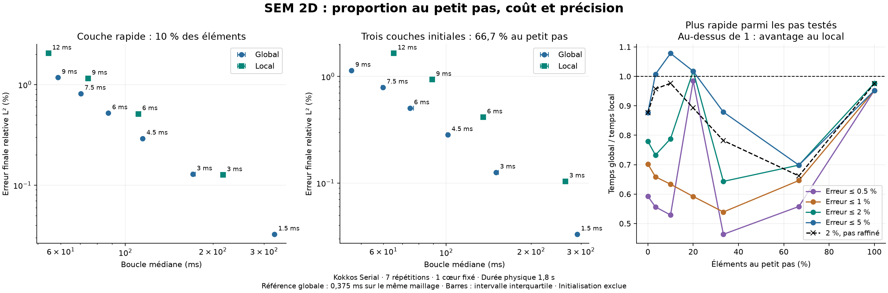

# Influence de la proportion d’éléments au petit pas

Étude CPU du 7 novembre 2026. Le benchmark explore la précision temporelle et le
temps de boucle du prototype LF-LTS à deux niveaux en faisant varier l’étendue
d’une couche rapide. Il conserve le solveur et le cas de validation précédents.

## Résultats

Après raffinement des pas autour du budget d’erreur finale de **2 %**, aucun
des huit modèles ne montre un temps local inférieur au temps global sélectionné.
Les petites différences de quelques pour cent restent à interpréter avec les
variations de fréquence et de charge de la machine.

| Éléments au petit pas | Modèle | Grand pas local | Pas global | Boucle locale médiane | Boucle globale médiane |
|---:|---|---:|---:|---:|---:|
| 0 % | Homogène | 11,538 ms | 11,538 ms | 54,31 ms | 47,59 ms |
| 3,33 % | Couche rapide de 1 rangée | 11,613 ms | 10,227 ms | 57,68 ms | 55,23 ms |
| 10 % | Couche rapide de 3 rangées | 11,842 ms | 9,783 ms | 58,64 ms | 57,26 ms |
| 20 % | Couche rapide de 6 rangées | 12 ms | 9,677 ms | 60,76 ms | 54,23 ms |
| 33,33 % | Couche rapide de 10 rangées | 11,765 ms | 9,626 ms | 62,37 ms | 48,77 ms |
| 66,67 % | Couche rapide de 20 rangées | 12 ms | 9,626 ms | 66,89 ms | 44,26 ms |
| 100 % | Homogène rapide | 8,219 ms | 4,091 ms | 113,99 ms | 111,22 ms |
| 66,67 % | Trois couches initiales | 12 ms | 9,626 ms | 71,04 ms | 47,03 ms |

Dans le cas à 10 %, les erreurs finales sont respectivement de 1,989 % pour
le local et 1,405 % pour le global. Dans le cas initial à trois couches, elles
valent 1,649 % et 1,303 % : le global sélectionné est à la fois plus rapide et
plus précis. Sur ce dernier cas, le surcoût local atteint environ 51 %.
Le témoin sans zone fine donne exactement les mêmes erreurs au même pas, mais
la boucle du prototype local coûte environ 14 % de plus.

Le premier balayage sur une grille de pas plus espacée semblait donner un
avantage local de 1,8 % au modèle à 20 % de zone fine, pour un budget de 2 %.
Cet avantage disparaît quand le pas global est affiné de 9 à 9,677 ms.
Pour le modèle à 10 %, le local à 12 ms produit une erreur de 2,042 %, juste
au-dessus du plafond : le saut de coût vers 9 ms dans la grille initiale était
également un effet de seuil. Le raffinement sélectionne 11,842 ms.

Les budgets plus lâches restent documentés dans `fraction_frontier.csv` :
à 5 %, la grille initiale donne notamment un avantage local d’environ 7,2 %
en temps de boucle dans le modèle à 10 %. **Ce budget de 5 % n’a pas fait
l’objet du raffinement des pas** et ce gain ne constitue donc pas un optimum
comparé. La conclusion ci-dessus concerne le budget raffiné de 2 %.

Les 672 répétitions du balayage, les 112 répétitions du raffinement et les
162 évaluations de recherche sont enregistrées. Les contrôles de cohérence
des CSV et les 74 tests de partition, d’intégration locale et de SEM 2D de
référence passent. L’écart entre les références globales à 0,75 et 0,375 ms
est compris entre 0,0137 et 0,0527 % selon le modèle.

La suite utile pour les performances est de mesurer séparément le coût des
opérateurs spatiaux et des parcours de vecteurs : le surcoût existe déjà sans
zone fine, et le prototype ajoute ensuite une correction sur le voisinage fin
ainsi que des parcours de tableaux de taille globale. Le simple fait de réduire
la proportion fine ne suffit pas à démontrer un gain dans ces expériences.



## Protocole

Le domaine mesure 6 000 × 3 000 m, avec 60 × 30 éléments carrés de 100 m,
un ordre SEM égal à 2 et 7 381 nœuds. Les bords sont rigides, la densité vaut 1,
et il n’y a ni source forcée ni amortissement. Le champ initial est la même
gaussienne que dans la validation à trois couches : centre `(3000, 2500)` m,
écart-type 160 m, dérivée temporelle nulle, avec `z` vers le haut.
La durée physique est de 1,8 s.

Sept modèles ont une couche inférieure à 3 000 m/s, de 0, 1, 3, 6, 10, 20
ou 30 rangées d’éléments, dans un fond à 1 500 m/s. Les proportions d’éléments
au petit pas sont donc 0, 3,33, 10, 20, 33,33, 66,67 et 100 %. Un huitième
modèle reprend les trois couches initiales à 1 500, 2 250 et 3 000 m/s.

- Pas globaux testés : 12, 10, 9, 7,5, 6, 4,5, 3 et 1,5 ms.
- Grands pas locaux testés : 12, 9, 6 et 3 ms ; rapport entre niveaux égal à 2,
  stabilisation `nu=0.01`.
- Partition locale fixée pour chaque modèle : le paramètre de sélection `cfl`
  est proportionnel au grand pas, avec `cfl=0.4` à 12 ms. Le benchmark vérifie
  que les listes d’éléments et de nœuds fins restent identiques.
- Référence : Verlet global à 0,375 ms sur le même maillage. Un second calcul
  à 0,75 ms mesure l’écart dû au raffinement de la référence.
- Erreur : norme L² relative du champ final, pondérée par la masse diagonale.
  Les champs sont en float32 ; les sommes d’erreur sur le host sont en float64.
- Deux échauffements par configuration puis sept répétitions, dans un ordre
  mélangé avec la graine `20261107` au sein de chaque modèle.
- Kokkos Serial, GCC 12.3 Release, Intel Core i9-13900HX, affinité sur le
  processeur logique 0. Le cœur n’est pas réservé et sa fréquence est gérée par
  le système ; les mesures ne sont donc pas faites à fréquence imposée.
- Les chronométrages de boucle excluent préparation, calcul d’erreur,
  copies vers le host et écritures. La préparation est mesurée séparément.
  Des `Kokkos::fence()` encadrent les mesures.

Pour chaque budget d’erreur (0,5, 1, 2 et 5 %), on retient séparément le local
et le global les plus rapides **parmi les pas testés** qui respectent le budget.
Le rapport `temps global / temps local` est supérieur à 1 lorsque le local est
plus rapide. Il compare un même plafond d’erreur ; les erreurs réalisées peuvent
différer. Il ne représente pas un optimum sur tous les pas possibles.

Les champs non finis restent dans les CSV, avec `finite=0` et une erreur infinie.
Les calculs dont l’erreur dépasse le budget sont exclus de la comparaison,
même si leur champ final reste fini.

### Raffinement du budget de 2 %

Une seconde exécution recherche séparément un nombre entier de pas pour le
global et le local, entre 150 et 1 200 pas sur 1,8 s. Elle utilise une dichotomie
sur le franchissement du plafond de 2 %, puis vérifie que le nombre de pas
retenu satisfait le budget et que son voisin immédiatement inférieur le
dépasse. Si 150 pas satisfont déjà le budget, la recherche s’arrête à cette
borne (12 ms). La partition locale reste identique et est vérifiée à nouveau.

Cette recherche suppose un franchissement exploitable par dichotomie dans
l’intervalle : elle ne prouve pas la monotonie globale de l’erreur, ni
l’optimalité sur tous les pas possibles. Près d’une limite de stabilité, le pas
sélectionné peut être limité par la croissance des erreurs, plutôt que par
leur convergence régulière. Le contrôle d’erreur reste celui du champ final
sur 1,8 s, sans certification spectrale.

Les deux candidats retenus sont échauffés deux fois puis mesurés sept fois
dans un ordre mélangé (graine `20261108`). Les comparaisons après raffinement
utilisent uniquement ces mesures appariées au sein de la seconde exécution ;
elles ne mélangent pas les temps des deux campagnes.

## Fichiers

- `fraction_samples.csv` : chronométrages et erreurs de chaque répétition.
- `fraction_summary.csv` : médianes et quartiles des 96 configurations.
- `fraction_scenarios.csv` : dimensions des zones et contrôle de la référence.
- `fraction_frontier.csv` : choix locaux/globaux respectant chaque budget.
- `budget_search.csv` : pas et erreurs évalués pendant la dichotomie à 2 %.
- `budget_samples.csv`, `budget_summary.csv`, `budget_comparison.csv` : mesures
  du raffinement, synthèse et comparaison des candidats retenus.
- `budget_protocol.json` : paramètres de recherche et de répétition.
- `fraction_protocol.json` : paramètres numériques et de chronométrage.
- `fraction_environment.json` : environnement, commande et empreintes de sources
  et du binaire utilisés.
- `06_fraction_precision_performance.png` : temps, erreurs et rapports de temps.

## Limites d’interprétation

Les erreurs comparent des intégrations temporelles sur un même maillage : elles
ne mesurent pas l’erreur spatiale face à une solution exacte. Elles portent sur
le champ à 1,8 s, sans certifier l’erreur maximale sur toute la trajectoire.
La vérification à 0,75 ms contrôle le raffinement de la référence ; elle ne
constitue pas une borne rigoureuse sur son erreur.

L’épaisseur de la couche rapide modifie aussi la propagation et les réflexions.
Les rapports de performance sont donc comparés au sein de chaque modèle, et
aucune loi universelle en fonction de la seule proportion fine n’est déduite.
Le voisinage des éléments fins et les parcours de vecteurs globaux contribuent
également au coût. Un champ final fini ne prouve pas la stabilité spectrale.
Ces mesures concernent ce prototype CPU, cet ordre et ces modèles sans source
ni absorption ; elles ne préjugent pas d’un gain sur GPU ou d’un cas applicatif.

## Reproduire

Depuis la racine du worktree, après la configuration CPU du
[README du composant](../../../../src/solver/impl/sem-local-time-step-2d/README.md) :

```bash
cmake --build build-lts-cpu --target sem2d_lts_fraction_benchmark -j 4
env -u LD_LIBRARY_PATH taskset -c 0 \
  build-lts-cpu/tests/validation/sem-local-time-step-2d/sem2d_lts_fraction_benchmark \
  documentation/acoustic/local-time-step/fraction-results 7
env -u LD_LIBRARY_PATH taskset -c 0 \
  build-lts-cpu/tests/validation/sem-local-time-step-2d/sem2d_lts_fraction_benchmark \
  documentation/acoustic/local-time-step/fraction-results 7 refine
../FUnTiDES-install/tpl-venv/bin/python \
  tests/validation/sem-local-time-step-2d/analyze_fine_fraction.py
```

Les commandes du binaire remplacent leurs CSV et protocoles dans le dossier indiqué.
Adapter le cœur si nécessaire et consigner l’environnement de la nouvelle
mesure dans `fraction_environment.json` : ce fichier est une photographie
de l’exécution enregistrée, pas une sortie automatique du binaire.
Le script d’analyse vérifie les répétitions, les médianes, les quartiles, les
durées physiques et les proportions fines avant de produire le tableau et la
figure. Il exige un écart entre références inférieur à 0,1 %.

## Étude suivante : petites inclusions rapides

Le [test d’inclusion à 4 500 m/s dans un fond à 1 500 m/s](../inclusion-results/README.md)
complète cette étude avec une région rapide de 0,89 % du domaine, des instantanés
et 51 récepteurs en surface. Le
[document mathématique et d’implémentation](../documentation-mathematique-et-implementation.md)
décrit le schéma, ses propriétés et l’extension envisagée aux pas non multiples.
