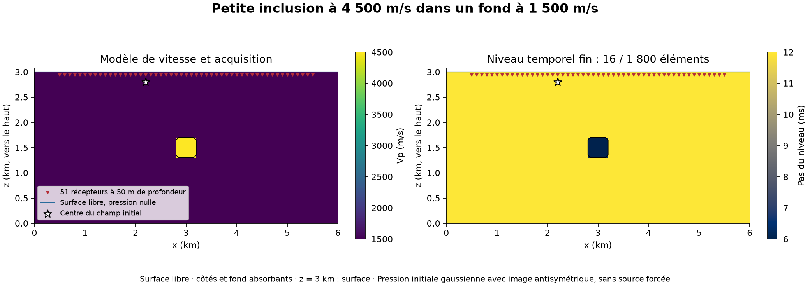
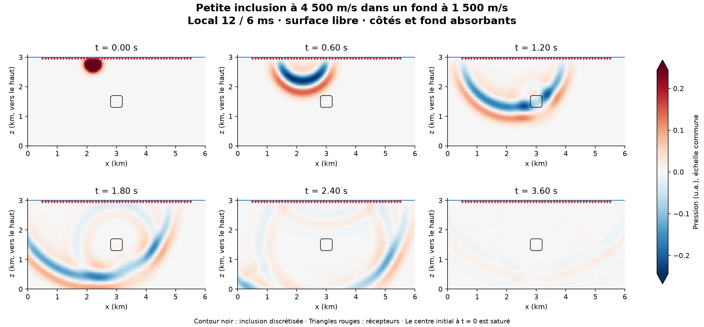
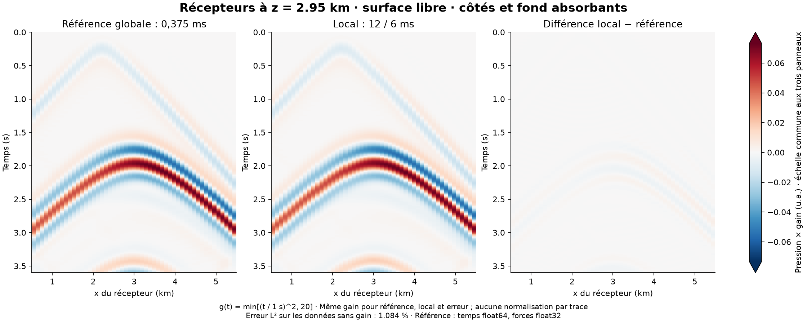
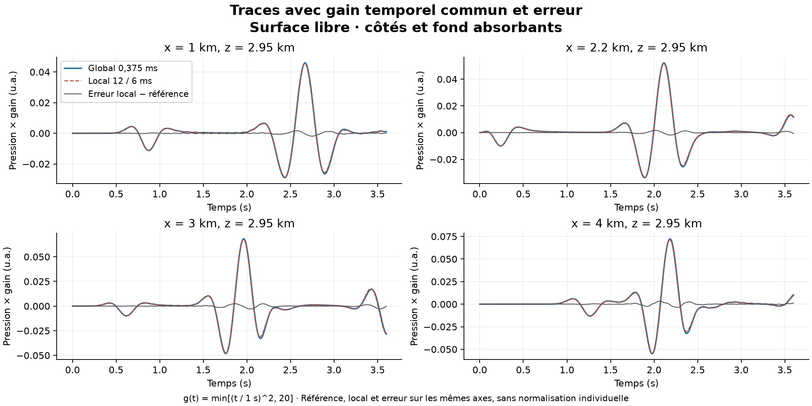
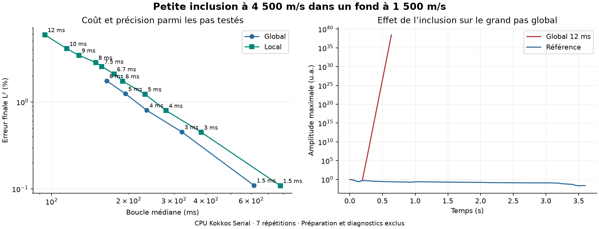

# Surface libre : temps de calcul et images

| Intégration | Temps médian de calcul |
|---|---:|
| Pas global (6 ms) | 164.08 ms |
| Pas local (12 / 6 ms) | 94.31 ms |

Boucle de propagation seule, sept répétitions sur le même cœur CPU et la même
durée physique de 3,6 s. Initialisation, diagnostics, copies host et écritures exclus.

Configuration : surface libre à pression nulle au sommet, côtés et fond absorbants ;
excitation initiale à 200 m sous la surface, récepteurs de pression à 50 m.
Le maillage reste uniforme (éléments de 100 m, ordre 2).

[Configuration](../../../../tests/validation/sem-local-time-step-2d/inclusion_free_surface.json) · [Détail mathématique](../documentation-mathematique-et-implementation.md)

## Modèle, excitation et récepteurs

Le bord supérieur est une surface libre à pression nulle (ligne bleue).
L’étoile indique le centre de l’excitation initiale, à 200 m sous la surface ;
les triangles rouges représentent les 51 récepteurs, à 50 m de profondeur.
La maille spatiale reste identique dans le fond et dans l’inclusion.

## Instantanés de propagation

Calcul local à 12 / 6 ms, avec absorption sur les côtés et au fond.
Les six instantanés partagent la même échelle de pression ; le pic initial est saturé.

## Sismogrammes et traces

Les récepteurs de pression sont à z = 2,95 km, sous la surface libre à z = 3 km.
Le calcul local et la référence globale sont enregistrés aux mêmes dates.
Un gain temporel **g(t) = min[(t / 1 s)², 20]** est appliqué à toutes les traces.
Le local, la référence et leur différence utilisent **exactement le même gain
et la même échelle de couleurs**, avec une seule barre commune. Les traces
individuelles montrent aussi l’erreur sur les mêmes axes. Le gain atténue les
premiers instants et renforce les arrivées tardives, sans normalisation par
récepteur. Les données CSV et les métriques d’erreur restent sans gain.

## Comparaison des calculs

