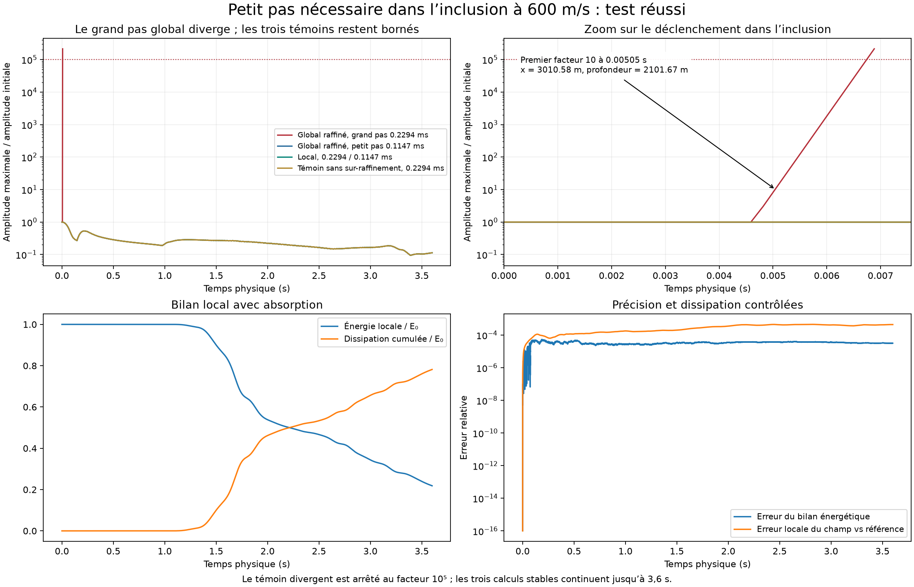
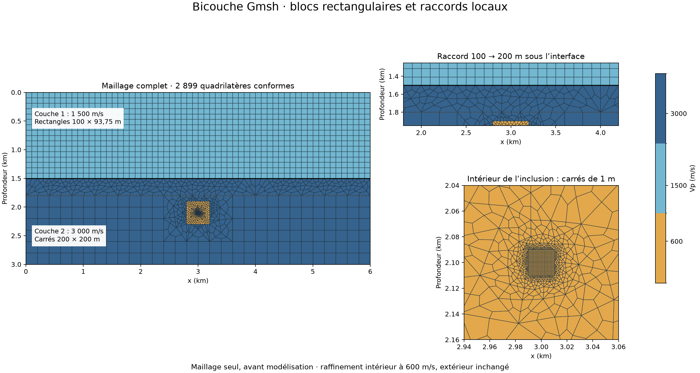
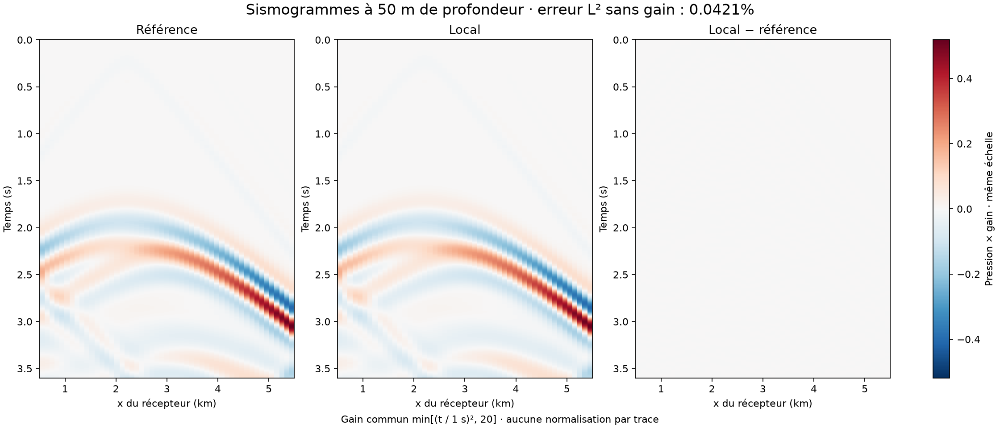
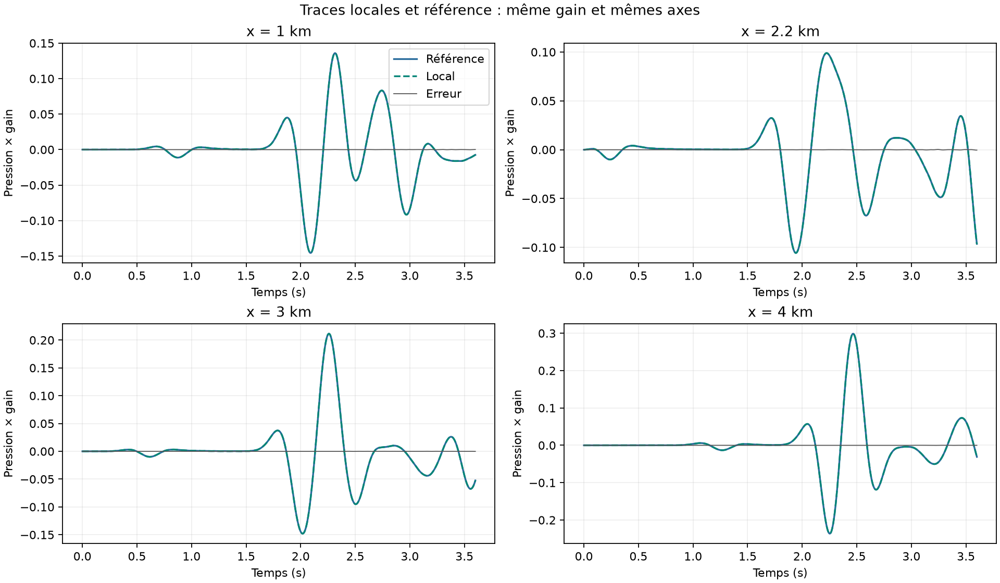

# Nécessité du petit pas dans l’inclusion à 600 m/s

**Test réussi le 8 novembre 2026.** Sur le maillage raffiné dans l’inclusion,
le global au grand pas diverge ; le global au petit pas et le local restent
stables et précis. Le témoin sans ce raffinement est stable au même grand pas.
Les critères sont fixés dans la [définition du test](../../../../tests/validation/sem-local-time-step-2d/gmsh_inclusion_stability_test.json).



## Les quatre calculs

| Cas | Pas | Résultat observé |
|---|---:|---|
| Témoin : maillage initial, inclusion à 40 m | Global 0,229446 ms | Stable sur 3,6 s |
| A : maillage raffiné dans l’inclusion | Global 0,229446 ms | Divergence initiée dans l’inclusion, arrêt à 0,006883 s |
| B : même maillage raffiné | Global 0,114723 ms | Stable sur 3,6 s |
| C : même maillage raffiné | Local 0,229446 / 0,114723 ms | Stable sur 3,6 s |

Le premier dépassement de dix fois l’amplitude maximale initiale se produit à
**0,005048 s**, en **x = 3 010,58 m**, **z = 898,33 m vers le haut**, soit
**2 101,67 m de profondeur**. Ce point est à l’intérieur de l’inclusion à
600 m/s. Le témoin A est arrêté au facteur **214 546**, au-delà du seuil de
10⁵. Les valeurs après cet arrêt sont laissées vides dans le CSV, sans prolonger
la courbe ni faire évoluer un champ divergent jusqu’aux NaN.

Les trois calculs stables ne dépassent jamais leur amplitude maximale initiale.
Le grand pas global suffit donc sur le maillage témoin, mais devient instable
quand on ajoute uniquement le raffinement intérieur. Dans ce cas de validation,
la réduction locale du pas élimine l’instabilité observée.

## Maillage et partition

Les vitesses restent **1 500 / 3 000 / 600 m/s**, avec densité uniforme 1.
Le domaine, les interfaces physiques, la surface libre et les côtés/fond
absorbants sont conservés. Le maillage extérieur est identique à celui du
[témoin](../gmsh-structured-results/README.md), vérifié par comparaison des
quadrilatères et matériaux indépendamment de leur numérotation, à 10⁻⁶ m près.

Un carré central de 20 × 20 m, x = 2 990–3 010 m et z = 890–910 m vers le
haut, reçoit **400 carrés de 1 m**. Son raccord au bord à 40 m de l’inclusion
est entièrement dans le matériau à 600 m/s. Les quadrilatères de ce raccord
peuvent être plus petits que les carrés centraux : les pas sont calibrés sur
l’opérateur assemblé de tout ce maillage, pas uniquement sur la taille de 1 m.

Total : **2 899 quadrilatères**, **11 735 nœuds GLL** à l’ordre 2. Le niveau
fin comporte **144 éléments**, tous à l’intérieur de l’inclusion ; **aucun
élément extérieur n’utilise le petit pas**. Le reste du domaine, y compris les
éléments de l’inclusion qui n’exigent pas le niveau fin, garde le grand pas.



Ce sur-raffinement est volontaire pour valider la nécessité du pas local.
Le cas initial, adapté à la longueur d’onde et maillé à 40 m dans l’inclusion,
ne présentait pas cette contrainte. Ces résultats ne démontrent pas un gain
de performance pour ce maillage de production.

## Précision et contrôles

L’excitation commune est le champ initial gaussien du cas précédent, avec
dérivée temporelle initiale nulle. Une perturbation déterministe d’amplitude
10⁻⁶, strictement intérieure au carré raffiné, excite les modes locaux. Les
cas A, B et C partent des mêmes valeurs nodales. Chaque intégrateur initialise
son niveau précédent conformément aux mêmes conditions initiales physiques.

| Mesure | Valeur | Critère |
|---|---:|---:|
| Erreur massique finale locale | 0,044108 % | < 1 % |
| Erreur massique finale globale au petit pas | 0,391405 % | < 1 % |
| Erreur L² des sismogrammes locaux sans gain | 0,042057 % | < 1 % |
| Écart entre les deux références temporelles | 0,00008491 % | < 0,1 % |
| Défaut maximal du bilan énergétique local | 5,47 × 10⁻⁵ | < 10⁻⁴ |
| Éléments fins hors inclusion | 0 | 0 |

La référence utilise le même maillage, un pas de **0,028681 ms**, la récurrence
temporelle float64 et les forces spatiales float32. Elle est comparée à une
référence au pas double. Les intégrateurs global et local testés utilisent
leurs mises à jour float32 habituelles. Leurs erreurs comprennent donc la
troncature temporelle et les arrondis ; leur classement ne constitue pas une
étude de convergence temporelle. L’erreur spatiale n’est pas mesurée ici.

Les champs des calculs stables et leurs traces sont finis, la surface libre
est maintenue à zéro dans les calculs raffinés, et le bilan énergie plus
dissipation est vérifié à chaque grand pas. Les **91 tests CPU** de partition,
LTS, SEM 2D et lecteur Gmsh passent après recompilation (`unit_tests.log`).





Le gain d’affichage `min((t / 1 s)², 20)` est commun au local, à la référence
et à leur différence ; les sismogrammes partagent une seule échelle. Les
erreurs sont calculées sans gain.

## Calibration et limites

Les estimations spectrales donnent 0,191275 ms pour le global sur le maillage
raffiné, contre 1,532431 ms sur le témoin. Le grand pas est choisi à environ
1,2 fois la première estimation, puis ajusté pour terminer exactement les
15 690 grands pas du calcul de 3,6 s. Le coefficient géométrique de partition
0,421398 permet le rapport 2 tout en gardant les éléments fins dans l’inclusion.

Les deux itérations de puissance atteignent leur plafond de 2 500 itérations,
avec des résidus relatifs de 1,12 × 10⁻⁴ et 1,36 × 10⁻⁴. Ces valeurs restent
des estimations, non des bornes certifiées. L’acceptation repose sur les
quatre comportements effectivement observés, la localisation de la croissance,
la précision et le bilan d’énergie. Le résultat concerne ces paramètres et
les 3,6 s simulées. Les mesures de temps sont réalisées séparément de cette
validation, selon le protocole ci-dessous.

## Temps de calcul

La boucle de propagation est chronométrée sur CPU Intel Core i9-13900HX,
avec Kokkos Serial en Release GCC 12.3 et affinité fixée au processeur logique 0.
Chaque scénario est échauffé deux fois, puis mesuré sept fois dans un ordre
mélangé. Des `Kokkos::fence()` encadrent la boucle. La préparation du solveur
est mesurée séparément ; lecture du maillage, diagnostics, copies host,
vérification des résultats et écritures restent hors du temps de propagation.

Les trois calculs stables parcourent les mêmes **3,6 s physiques**. Le global
instable est chronométré sur ses **30 pas jusqu’au seuil de divergence**, soit
0,006883 s physiques. Son temps tronqué ne participe à aucun calcul de gain.
Le témoin utilise un maillage plus petit ; la comparaison du local avec le
global au petit pas porte, elle, sur le même maillage raffiné.

Chaque répétition contrôle le champ final : absence de valeurs non finies,
amplitude attendue et, pour les deux intégrations stables du maillage raffiné,
erreur face à la référence déjà enregistrée inférieure à 1 %. Les mesures
brutes sont dans `timing_samples.csv`, les statistiques dans
`timing_summary.csv` et les empreintes de l’exécution dans `timing_protocol.json`.

***Durées mesurées*** — médianes de sept répétitions, en secondes. La durée de
propagation est la boucle chronométrée ; la préparation est mesurée séparément.
L’intervalle entre crochets donne les quartiles 25–75 % de la boucle.

| Calcul | Durée simulée | Préparation | Propagation médiane [Q25–Q75] | Total solveur médian |
|---|---:|---:|---:|---:|
| Témoin, global au grand pas | 3,6 s | 0,00196 s | 4,171 s [3,933–4,458] s | 4,173 s |
| Raffiné, global au petit pas | 3,6 s | 0,00411 s | 15,107 s [14,088–17,035] s | 15,111 s |
| Raffiné, local | 3,6 s | 0,00598 s | 9,627 s [8,491–12,687] s | 9,633 s |
| Raffiné, global instable | 0,006883 s (30 pas) | 0,00423 s | 0,0406 s [0,0380–0,0472] s | 0,0449 s |

Sur le même maillage raffiné et pour les mêmes 3,6 s physiques, le calcul local
réduit la durée médiane de propagation de **36,3 %** par rapport au global au
petit pas (facteur **1,57**). Le témoin utilise un maillage différent : son
temps n’est pas une comparaison directe de performance. Le calcul global
instable s’arrête après 30 pas et sa durée n’est pas comparable aux calculs
complets.

Pour reproduire ces chronométrages après la validation :

```bash
cmake --build build-lts-cpu --target sem2d_gmsh_inclusion_timing -j 4
env -u LD_LIBRARY_PATH taskset -c 0 \
  build-lts-cpu/tests/validation/sem-local-time-step-2d/sem2d_gmsh_inclusion_timing \
  documentation/acoustic/local-time-step/gmsh-structured-results \
  documentation/acoustic/local-time-step/gmsh-inclusion-stability-results \
  documentation/acoustic/local-time-step/gmsh-inclusion-stability-results/timing_parameters.txt 7
../FUnTiDES-install/tpl-venv/bin/python \
  tests/validation/sem-local-time-step-2d/plot_gmsh_inclusion_timings.py
```

`timing_parameters.txt` contient le grand pas, le coefficient de partition,
le nombre de grands pas et les 30 pas du témoin instable, extraits des
résultats validés. Ces commandes remplacent seulement les chronométrages
et leur figure.

## Reproduire

Depuis la racine du worktree, avec la configuration CPU restaurée :

```bash
../FUnTiDES-install/tpl-venv/bin/python \
  tests/validation/sem-local-time-step-2d/generate_gmsh_bilayer.py \
  --config tests/validation/sem-local-time-step-2d/gmsh_inclusion_refined.json \
  --output documentation/acoustic/local-time-step/gmsh-inclusion-stability-results
../FUnTiDES-install/tpl-venv/bin/python \
  tests/validation/sem-local-time-step-2d/plot_gmsh_mesh.py \
  --results documentation/acoustic/local-time-step/gmsh-inclusion-stability-results
cmake --build build-lts-cpu --target sem2d_gmsh_inclusion_stability -j 4
env -u LD_LIBRARY_PATH taskset -c 0 \
  build-lts-cpu/tests/validation/sem-local-time-step-2d/sem2d_gmsh_inclusion_stability \
  documentation/acoustic/local-time-step/gmsh-structured-results \
  documentation/acoustic/local-time-step/gmsh-inclusion-stability-results 1.2
../FUnTiDES-install/tpl-venv/bin/python \
  tests/validation/sem-local-time-step-2d/plot_gmsh_inclusion_stability.py
```

Les commandes remplacent les sorties de ce cas. `test_result.json` contient
les critères mesurés ; `analysis_checks.json` consigne les contrôles indépendants
des CSV. La géométrie et la conformité sont dans `mesh_checks.json`, les
spectres dans `coarse_spectrum/` et `refined_spectrum/`. Le journal et les
empreintes de l’environnement de calcul sont conservés dans `modeling.log`
et `run_environment.json`.
