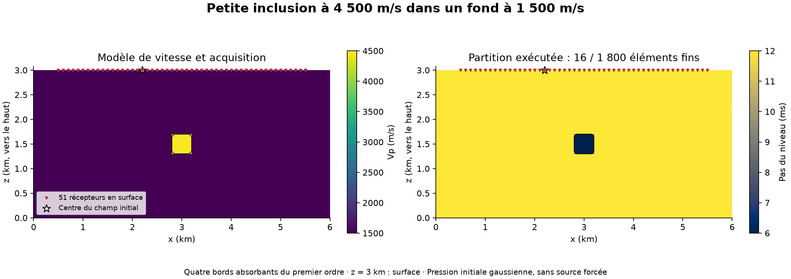
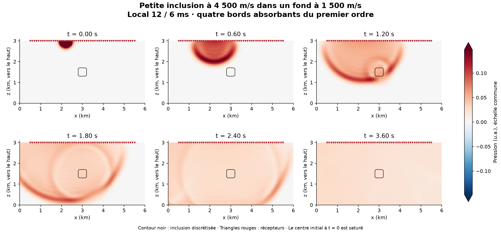
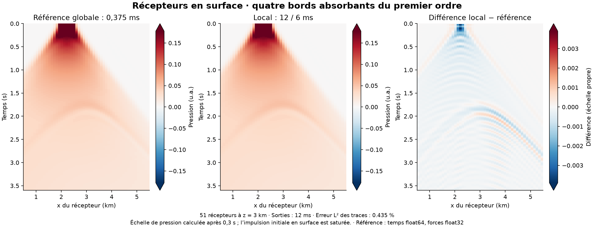
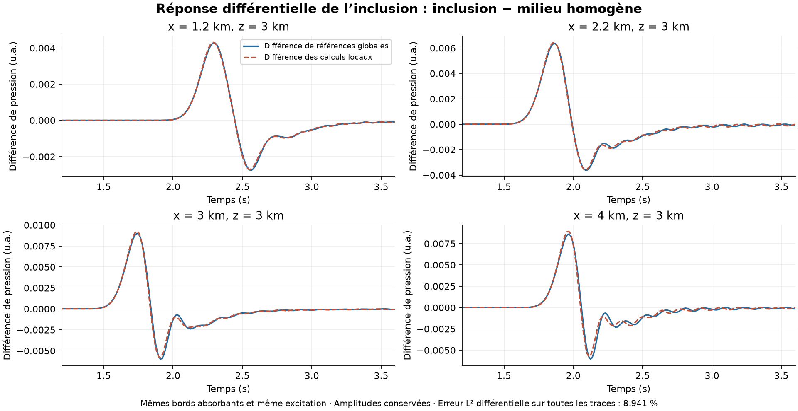
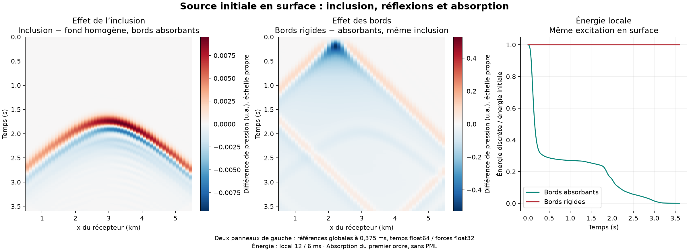

# Excitation en surface et bords absorbants

**Campagne historique.** La configuration courante remplace le bord supérieur
absorbant par une surface libre et déplace l’excitation sous celle-ci :
[surface libre et temps de calcul](../free-surface-results/README.md).

Campagne du 7 novembre 2026. Le centre de la même impulsion initiale gaussienne
est déplacé à **`(2200, 3000)` m**, sur le bord supérieur. Les **quatre bords**
utilisent une condition absorbante du premier ordre. Un témoin conserve les
bords rigides avec exactement la même excitation en surface.

Le **maillage spatial ne change pas** : 60 × 30 éléments de 100 × 100 m,
ordre SEM 2, 7 381 nœuds. Le fond est à 1 500 m/s et le carré de 400 × 400 m
à 4 500 m/s. Ses 16 éléments représentent 0,89 % du domaine. Les niveaux
**12 / 6 ms** sont des niveaux temporels ; il n’y a aucun raffinement spatial.

La durée est portée à **3,6 s** pour observer le retour de la réponse de
l’inclusion vers les 51 récepteurs en surface, toujours à `z=3000 m`, entre
`x=500` et `5500 m`. Il s’agit d’une **condition initiale de pression**,
d’écart-type 160 m et de dérivée temporelle nulle, sans source temporelle forcée.
La surface n’est pas à pression nulle.

## Géométrie et instantanés



Les instantanés du calcul local sont à 0, 0,6, 1,2, 1,8, 2,4 et 3,6 s.
Le contour noir repère l’inclusion, les triangles rouges les récepteurs.
L’échelle de pression est commune ; le maximum initial est saturé.



## Traces en surface et réponse de l’inclusion

Le calcul local à 12 / 6 ms est comparé à une référence globale à **0,375 ms**,
avec exactement les mêmes bords absorbants. Les sorties sont aux mêmes dates,
espacées de 12 ms, sans interpolation temporelle.



L’erreur L² relative est de **0,435 % sur les traces complètes**. Cette métrique
inclut le signal direct et la forte impulsion initiale au récepteur voisin de
la source. Elle ne mesure pas uniquement la précision des faibles retours de
l’inclusion. Pour les voir, on soustrait les traces du témoin homogène absorbant
à celles du modèle avec inclusion, séparément pour le local et la référence.

L’erreur relative sur cette **réponse différentielle de l’inclusion est de
8,94 %**, pour le même local à 12 / 6 ms. Les amplitudes sont conservées dans
la figure suivante. Le détail de cette réponse demande donc un contrôle plus
exigeant que la seule erreur sur les traces complètes.



## Absorption et bilan d’énergie

La matrice diagonale de bord `D` est assemblée avec le coefficient `1/(rho*vp)`.
Le schéma temporel centre le terme amorti. Son énergie discrète décroît de
`H * v_center^T D v_center` par grand pas, avec
`v_center=(u_next-u_prev)/(2*H)`. Le code cumule cette dissipation et vérifie le
bilan **énergie restante + énergie dissipée = énergie initiale**.

| Mesure, une inclusion, local 12 / 6 ms | Valeur |
|---|---:|
| Énergie restante à 3,6 s, bords absorbants | 0,0825 % de l’énergie initiale |
| Énergie dissipée cumulée | 99,9175 % |
| Énergie restante, témoin rigide | 99,99999 % |
| Défaut relatif maximal du bilan absorbant | 2,07 × 10⁻⁷ |
| Erreur finale L² du champ face à la référence | 0,989 % |
| Erreur maximale du champ aux dates de sortie | 1,981 % |



Le panneau central montre la différence entre bords rigides et absorbants ;
elle inclut aussi le changement de rayonnement près de l’excitation située
sur le bord. Elle n’est donc pas une mesure isolée d’un coefficient de réflexion.
La condition du premier ordre n’est pas une PML : des réflexions résiduelles
à incidence oblique ou aux coins peuvent subsister.

Une faible composante quasi constante de pression peut rester visible après
le départ des ondes. Les bords absorbants employés admettent un champ constant
stationnaire, qui ne contribue pas à l’énergie de gradient et dont la dérivée
temporelle est nulle. L’impulsion initiale positive n’a pas une moyenne nulle :
une énergie dynamique faible ne signifie donc pas une pression identiquement
nulle partout.

## Précision de la référence

Le premier contrôle avec la récurrence globale entièrement en float32 donnait
**1,154 %** d’écart entre 0,75 et 0,375 ms sur le champ final. Le contrôle
automatique l’a refusé. Le champ final, après absorption de presque toute
l’énergie dynamique, est sensible à l’arrondi de la récurrence.

Pour cette campagne, les deux champs de **mise à jour temporelle de référence**
et le démarrage de Taylor sont accumulés en float64. Les forces spatiales,
la masse, les coefficients de bord et l’état passé à l’opérateur spatial
restent en float32. Ce choix de précision mixte réduit l’écart de raffinement
à **0,00584 %** pour l’inclusion absorbante. Il est enregistré dans les
paramètres, les métadonnées et le protocole. Les calculs comparés pour leur
performance gardent leur récurrence float32 normale.

## Temps de calcul

Pour les pas de la grille testée, avec un plafond d’erreur **finale** de 1 % :

| Solveur | Pas | Erreur finale L² | Temps médian de boucle |
|---|---|---:|---:|
| Global | 6 ms | 0,460 % | 151,52 ms |
| Local | 12 / 6 ms | 0,989 % | 89,51 ms |

La réduction du temps de boucle est de **40,9 % pour ces deux choix**. Les
erreurs réalisées diffèrent et les pas n’ont pas été optimisés continûment.
Le plafond de 1 % porte sur le champ final, pas sur l’erreur maximale pendant
le calcul ni sur la réponse différentielle de l’inclusion.

Protocole CPU : Kokkos Serial, GCC 12.3 Release, Intel Core i9-13900HX, affinité
sur le processeur logique 0. Deux échauffements par configuration, sept mesures
dans un ordre mélangé. La boucle exclut préparation, diagnostics, copies host
et écritures ; la préparation est enregistrée séparément. Le cœur n’est pas
réservé et sa fréquence n’est pas imposée.

## Cas, données et reproduction

La [configuration](../../../../tests/validation/sem-local-time-step-2d/inclusion_surface_absorbing.json) définit quatre cas :

- `single_4500` : inclusion carrée et quatre bords absorbants ;
- `single_4500_rigid_surface` : même inclusion et même excitation, bords rigides ;
- `homogeneous_1500` : témoin homogène avec les mêmes bords absorbants ;
- `multiple_noninteger_targets` : carré à 4 500 m/s et disque à 3 600 m/s,
  avec bords absorbants.

Les pas cibles 12, 4 et 5,5 ms sont conservés sans arrondi dans ce dernier
modèle. L’intégrateur les exécute toujours selon sa partition à deux niveaux
de rapport 2, et non comme trois pas indépendants.

Depuis la racine du worktree :

```bash
cmake --build build-lts-cpu --target sem2d_lts_inclusion_benchmark -j 4
../FUnTiDES-install/tpl-venv/bin/python \
  tests/validation/sem-local-time-step-2d/prepare_inclusions.py \
  --config tests/validation/sem-local-time-step-2d/inclusion_surface_absorbing.json \
  --output documentation/acoustic/local-time-step/surface-absorbing-results
```

Pour chaque cas, remplacer `single_4500` dans les deux commandes suivantes :

```bash
env -u LD_LIBRARY_PATH taskset -c 0 \
  build-lts-cpu/tests/validation/sem-local-time-step-2d/sem2d_lts_inclusion_benchmark \
  documentation/acoustic/local-time-step/surface-absorbing-results/single_4500 7
../FUnTiDES-install/tpl-venv/bin/python \
  tests/validation/sem-local-time-step-2d/plot_inclusions.py \
  --results documentation/acoustic/local-time-step/surface-absorbing-results/single_4500
```

Puis créer la comparaison entre modèles :

```bash
../FUnTiDES-install/tpl-venv/bin/python \
  tests/validation/sem-local-time-step-2d/plot_inclusions.py \
  --results documentation/acoustic/local-time-step/surface-absorbing-results \
  --compare-surface
```

Les commandes remplacent les sorties de la campagne indiquée, sans modifier
les résultats antérieurs dans `inclusion-results/`. Chaque sous-dossier
contient les modèles, paramètres, 182 chronométrages, résumé, instantanés,
traces et bilans. Les diagnostics proviennent du C++ ; Python contrôle et
trace les CSV. Le dossier racine contient aussi `surface_comparison.json`
et `environment.json` pour les conditions et empreintes de la campagne.

Les **82 tests de régression passent**, dont huit nouveaux cas sur
l’amortissement. La formulation et la preuve du bilan figurent en
[section 12 du document technique](../documentation-mathematique-et-implementation.md).
