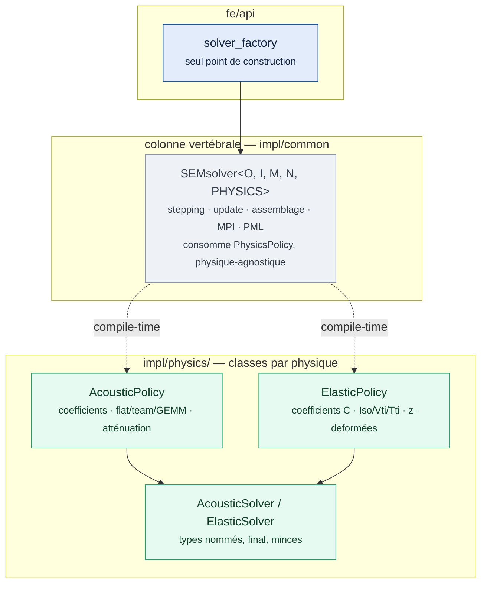

# Note de design — Hiérarchie de solveurs par physique (politiques compile-time)

**Date** : 2026-10-15
**Statut** : À relire par l'utilisateur — **aucun remaniement avant validation de cette note**
**Base** : branche `refactor/src-solver` (fragments en place, PR ouverte)
**Décision actée** : architecture en classes dérivées par physique — `SEMsolver` en haut, `AcousticSolver`/`ElasticSolver` en dessous — avec mécanisme compile-time (politiques), zéro vtable sur les chemins GPU.

---

## 1. Objectif

Concentrer la variance par physique en classes nommées et dérivées, demandées par l'utilisateur, sans payer le coût d'un dispatch virtuel dans les noyaux GPU. La colonne vertébrale algorithmique (stepping, update, assemblage, échange MPI, PML, sources) reste unique ; chaque physique devient une classe qui porte ses coefficients, ses noyaux d'élément et sa compensation d'amortissement.

## 2. État actuel (relevé dans le code, branche `refactor/src-solver`)

La physique est un paramètre template `PHYSICS` de `SEMsolver` ; la variance est **distribuée** en trois points de dispatch imbriqués :

1. **`sem_solver_step.h` l.211-222** — `computeElementContributions()` : `if constexpr (PHYSICS == kElastic)` aiguille vers `_*Iso/_Vti/_Tti` (anisotropie), sinon `_*Acoustic`.
2. **`sem_solver_kernels.h`** — 16+ corps membres par variante : `computeElementContributions_Acoustic{,_Gemm,_Flat,_FlatZ,_TeamZ}`, `_{Iso,Vti,Tti}{,_Flat,_Team,_TeamZ}` (l.34-1606), plus `computeAttenuationContributions{Acoustic,Elastic}` (l.615-626).
3. **`sem_solver_assembly.h`** — coefficients : `computeCMatrix` (l.283) et `computeTtiCompact` (l.410), membres spécialisés par physique.

Les traits existants (`fe/api/include/physics_traits.h`, spécialisations acoustique/élastique dans chaque arbre `impl/`) exposent déjà `kName`, `WavefieldType`, `RhsType` — c'est le germe du contrat.

## 3. Contrat `PhysicsPolicy`

Chaque physique expose une classe de politique satisfaisant le contrat ci-dessous. Le cœur `SEMsolver` consomme la politique via `using Physics = ...` — **résolution entièrement statique**, signatures inchangées, aucun coût runtime.

```cpp
// fe/api — le contrat (une seule page, documentée)
template <physicType PHYSICS>
struct PhysicsPolicy {
  using Traits = PhysicsTraits<PHYSICS>;          // existant
  static constexpr int kNumFields = Traits::WavefieldType::kNumFields;
  static constexpr int kNumRhs    = Traits::RhsType::kNumRhsComponents;

  // Coefficients constitutifs au point de Gauss (extraits d'assembly)
  // (computeCMatrix, computeTtiCompact deviennent des statiques de politique)

  // Application d'élément : la politique reçoit l'élément, la géométrie,
  // les champs, et applique sa loi constitutive. Le cœur ne sait plus
  // quelle physique tourne : computeElementContributions() devient
  //   Physics::applyElement(data);   // aiguillage interne à la politique
  // (les variantes flat/team/z restent des choix internes à la politique)

  // Compensation d'amortissement (extraites de kernels l.626+)
};
```

Points de design tranchés :

- **les variantes d'implémentation (flat/team/GEMM/z) restent internes à chaque politique** — le cœur ne voit pas `computeElementContributions_Acoustic_TeamZ`, il voit `Physics::applyElement`. C'est la disparition du point le plus diffus du code actuel ;
- **l'anisotropie (Iso/Vti/Tti) est un sous-choix de la politique élastique**, pas une politique séparée : c'est une variante de la même loi constitutive, le code actuel le structure déjà ainsi ;
- **aucune méthode virtuelle** sur un chemin appelé depuis un functor Kokkos — non négociable, documenté ici comme règle du dépôt.

## 4. Hiérarchie cible



Les arêtes pointillées sont des relations compile-time (paramètre template), pas des appels virtuels. `AcousticSolver`/`ElasticSolver` sont des sous-classes `final` minces au-dessus du template configuré — l'API dit son nom, la fabrique et pywrap inchangés contractuellement.

## 5. Choix de mécanisme : politique par paramètre template vs CRTP

**Décision : politique par paramètre template** (`SEMsolver` reçoit la politique via `PHYSICS` et le résout en `PhysicsPolicy<PHYSICS>`), pas CRTP. Motifs :

- le CRTP n'achète rien ici : la variance est portée par des fonctions libres de la politique, pas par des méthodes du solveur spécialisées ;
- il préserve le paramètre `PHYSICS` existant partout (instantiations explicites, fabrique, 104 TU générés) — aucun re-templating en cascade ;
- la spécialisation actuelle `template <physicType P, typename>` des corps membres devient simplement des membres statiques de classe politique — même mécanisme de compilation.

## 6. Plan de migration (chaque pas : build elba-b02 + proxies + gtest ; rouge → revert du pas)

| # | Pas | Porte |
|---|---|---|
| 1 | `impl/physics/acoustic/policy.h` : coefficients `computeCMatrix` acoustique extraits d'assembly | proxies + gtest acoustique |
| 2 | Noyaux flat → team → GEMM déplacés, le cœur appelle `Physics::applyElement` | chaque variante : proxies + gtest |
| 3 | Atténuation acoustique extraite | gtest atténuation |
| 4 | `impl/physics/elastic/policy.h` : `computeCMatrix`/`computeTtiCompact` élastiques | gtest élastique + (voir §7) |
| 5 | Noyaux Iso → Vti → Tti → z-deformés déplacés | idem |
| 6 | `AcousticSolver`/`ElasticSolver` nommés + fabrique inchangée | validation complète + smoke pyfuntides |

La fourche acoustoélastique **reste spectatrice** : non migrée, documentée comme avant. Elle devient composable en cible finale (deux solveurs spécialisés + couplage) une fois les politiques stables.

## 7. Étanchéité de l'oracle — décision à prendre (utilisateur)

Les références proxy scellées couvrent acoustique + élastique isotrope. TTI/VTI/z-deformé/atténuation ne sont couverts que par gtest. Le port TTI du 2026-10-15 (`6f92da70`) a montré le risque concret : un correctif dans une spécialisation que l'oracle proxy n'aurait pas attrapé.

- **Option (a), recommandée** : étendre le harnais proxy à un cas élastique TTI (harnais existant, cas ~90 lignes, scellement ~10 min sur elba-b02) — chaque physique déplacée a alors sa référence scellée.
- **Option (b)** : accepter gtest comme porte unique pour ces variantes, risque résiduel documenté.

## 8. Validation finale d'étape

Proxies `sem_acoustic`/`sem_elastic` (et le cas TTI si option (a)) vs références scellées : `l2_rel < 1e-3`, `finite=1`. `solver_tests` complet (attention : exécution séquentielle des cas gtest via ctest ~25 min). Smoke pyfuntides GPU. Mise à jour de `fe/README.md` (hiérarchie) et du rapport. **Revue utilisateur avant tout commit de fusion.**

## 9. Risques

- **Chemin d'inclusion** : les politiques vivront dans `impl/physics/` et doivent rester hors de `fe/api` (détails d'implémentation) ; seule la fabrique et les types nommés sont publics.
- **Instantiations explicites** : les 104 TU générés référencent les corps par leur nom qualifié actuel — le pas 2/5 change la qualification, le générateur `add_solver_instantiations()` devra suivre. Piste : tester d'abord un seul ordre (Q2) bout en bout avant de dérouler.
- **`sem_solver_data.h`** : déjà paramétré par traits — devrait suivre sans remaniement.
- **Multi-sessions** : chantier estimé à plusieurs sessions ; chaque pas est indépendamment revertible, la branche reste fusionnable à tout pas vert.
