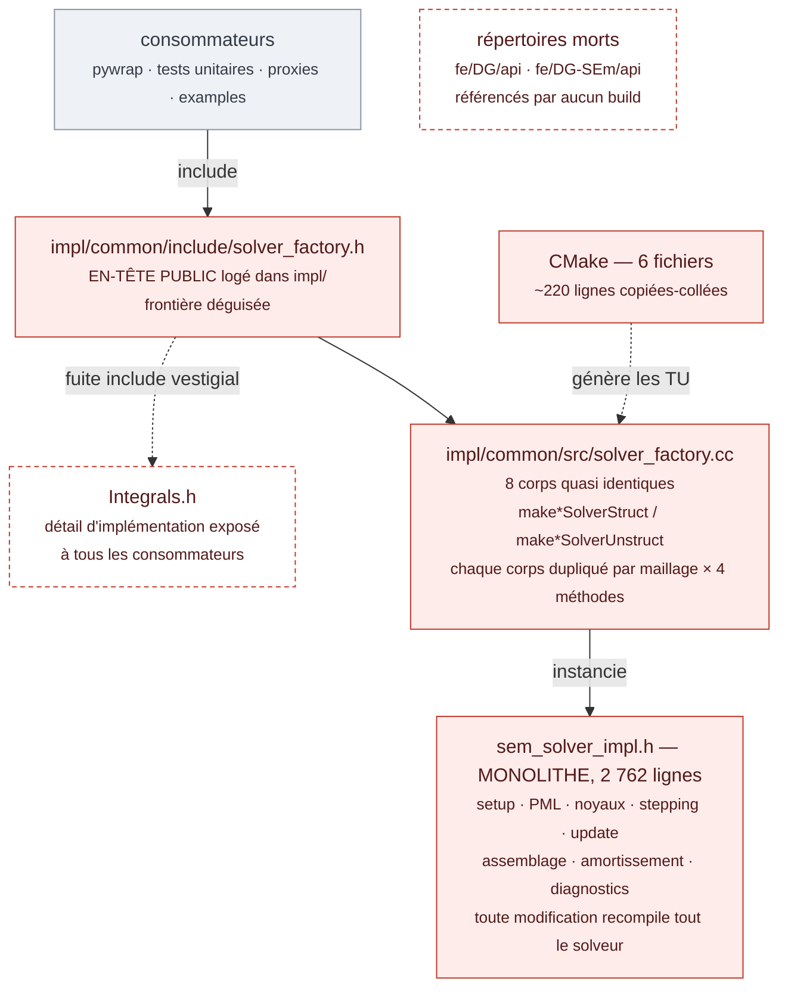
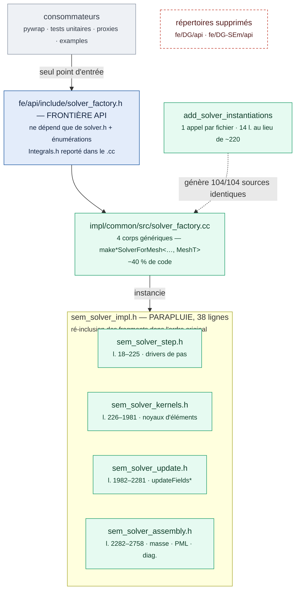

# Rapport — Refactor de `src/solver` : couplages, architecture, redondance

**Date** : 2026-10-15
**Branche** : `main` (dépôt FUnTiDES, aucun commit — en attente de revue)
**Arbitre** : serveur proxy MIMIR (proxies `sem_acoustic` / `sem_elastic`, oracle `l2_rel` scellé)
**Contraintes respectées** : travail sur `main` uniquement ; aucun commit sans feu vert de l'utilisateur ; aucun contact avec les jobs FWI après l'incident du 14-10 (règle enregistrée).

> **Addendum — itération de revue (2026-10-19).** Sur commentaires d'un
> développeur, trois changements ont suivi ce rapport : (1) la couche `fe`
> (vestige de la cohabitation avec les solveurs `fd`, supprimés depuis) est
> retirée — `src/solver/fe/{api,impl,pywrap}` devient `src/solver/SEM/`, les
> variantes `fe/DG*` passent à la racine `src/solver/`, et le namespace
> `solver::fe` devient `solver` (convention dossier = namespace, comme
> `src/gradient`) ; (2) le fragment `sem_solver_assembly.h` est renommé
> `sem_solver_init.h` (son contenu initialise : masse, amortissement,
> allocations, sponge), ses points d'entrée sur sous-ensembles
> (`*Masked`, `*FromList`) sont extraits vers
> `sem_solver_element_subset.h`, et les constructeurs de tenseur TTI
> (`computeCMatrix`, `computeTtiCompact`) rejoignent `sem_solver_kernels.h` ;
> (3) le point « compiler une seule physique/méthode/maillage » est acté
> pour plus tard (retaper la fabrique). Les chemins cités dans le corps de ce
> rapport décrivent l'état du 2026-10-15 (avec `fe/`) et ne sont pas
> rétro-corrigés.

> **Addendum 2 — itération de revue 2 (2026-10-19).** Deuxième passe sur
> commentaires du développeur : l'API devient **commune à toutes les
> méthodes** et l'arbre est restructuré selon son croquis. Le contrat
> (`solver.h`, `wavefield.h`, `rhs.h`, `physics_traits.h`) est hissé à
> `src/solver/api/`, indépendant de toute méthode ; la fabrique est sortie du
> sous-arbre SEM vers `src/solver/factory/` (`solver_factory.{h,cc}`), seule
> à connaître toutes les méthodes. Chaque méthode vit en minuscules avec sa
> colonne vertébrale dans `common/` et ses physiques en sous-arbres
> `{include,src}` : `sem/{common,acoustic,elastic,acoustoelastic,pywrap}`,
> `dg/`, `dgsem/`, `dg_padaptive/` (les trois dernières réduites à
> l'acoustique, comme avant). Les types et noyaux par physique de
> `sem/impl/physics/` sont fondus dans `sem/{acoustic,elastic}`
> (`sem_solver_{acoustic,elastic}_impl.h`, ex-`*_kernels.h`). Les fichiers
> des variantes DG suivent : `dg-sem_*.h` → `dgsem_*.h`. Le namespace reste
> `solver` partout ; `fun_solver` est déclaré dans `sem/CMakeLists.txt`,
> la fabrique s'y raccroche par `target_sources`. Validation identique :
> build des 6 cibles, `solver_tests` 463/463 (1 skip AE préexistant), trois
> oracles proxy vs références scellées (`l2_rel < 1e-3`).

---

## 1. Objectif et périmètre

Nettoyer/refactoriser `src/solver` : optimiser les couplages (POO), l'architecture, la redondance de code et l'organisation générale — **sans changer aucun comportement**, prouvé par le serveur proxy contre des références scellées.

Hors périmètre : `src/discretization`, `src/utils`, toute modification de physique, les bindings Python (décision motivée §3.1).

## 2. Constat initial

`src/solver/fe` contient quatre arbres parallèles : l'arbre principal SEM (`fe/api`, `fe/impl`, `fe/pywrap` → cible `fun_solver`) et trois variantes DG (`fe/DG`, `fe/DG-SEm`, `fe/DG_padaptive`) activées par `COMPILE_DG{,_SEM,_PADAPTIVE}`. Le monolithe header-only `sem_solver_impl.h` (127,6 KB, 2 762 lignes) concentrait tout : setup, PML, noyaux, stepping, assemblage. Deux répertoires `api/` de variantes étaient morts. La fabrique portait 8 corps de construction quasi identiques.

## 2bis. Graphes de dépendances — avant / après

Deux graphes de dépendances compile-time, un par état, en blocs **mermaid** dans le style de `ARCHITECTURE.md` de MIMIR : `graph TD`, étiquettes `<br/><small>`, arêtes étiquetées (pointillées = fuite/dépendance latérale), coloration par `classDef`. Ils se lisent de haut en bas : chaque couche dépend de celle du dessous.

### AVANT le refactor



L'en-tête public logé dans `impl/common/include` fuit `Integrals.h` vers tous les consommateurs ; la fabrique porte 8 corps dupliqués par maillage ; le monolithe `sem_solver_impl.h` (2 762 l.) concentre setup, PML, noyaux, stepping, update, assemblage, amortissement et diagnostics ; la logique de génération CMake est copiée-collée dans 6 fichiers (~220 l. redondantes) ; `fe/DG/api/` et `fe/DG-SEm/api/` sont des répertoires morts.

### APRÈS le refactor



`fe/api/include/solver_factory.h` devient la frontière (seul point d'entrée, ne dépend que de `solver.h` et des énumérations, `Integrals.h` reporté dans le `.cc`) ; 4 corps de fabrique génériques paramétrés par `MeshT` ; le parapluie `sem_solver_impl.h` (38 l.) ré-inclut dans l'ordre original les 4 fragments `step`/`kernels`/`update`/`assembly` (bornes de lignes originales indiquées) ; `add_solver_instantiations()` remplace la logique dupliquée (sources générées 104/104 identiques) ; les répertoires morts sont supprimés.

### Lecture du graphe

| Couplage | Avant | Après |
|---|---|---|
| Frontière api↔impl | en-tête public logé dans `impl/common/include`, fuyant `Integrals.h` | `fe/api/include/solver_factory.h`, dépendances minimales ; include interne reporté dans le `.cc` |
| Fabrique | 8 corps dupliqués par maillage | 4 corps génériques paramétrés par `MeshT` |
| Monolithe | un fichier de 2 762 l. concentre tout | parapluie + 4 fragments thématiques, ordre de définition inchangé |
| CMake | ~220 lignes de logique copiée ×6 | 1 fonction, 1 appel par fichier |
| Répertoires morts | 2 × `api/` orphelins | supprimés |

Les flèches verticales sont des dépendances compile-time (`#include` / instanciation) ; la frontière API est désormais le seul point d'entrée des consommateurs, et aucune dépendance ne remonte de `impl` vers `api` au-delà de ce qui est exposé.

## 3. Travaux réalisés (cinq axes)

### 3.1 Axe 1 — Échafaudage et documentation

- **Supprimé** : `fe/DG/api/` et `fe/DG-SEm/api/` (CMakeLists orphelins, jamais référencés par le build, sans `include/`).
- **Documenté** : `src/solver/fe/README.md` — layout des arbres, composition des types (voir ci-dessous), traits, bindings, fabrique, découpage du monolithe, décision sur la fourche acoustoélastique.
- **Décisions motivées** (adaptations vs plan initial, après diff exact) :
  - *wavefields/RHS* : la déduplication existait déjà par composition (`DGSEMWavefieldAcoustic` = `DGWavefieldAcoustic` + `WavefieldAcoustic` ; `DGPAdaptiveWavefieldAcoustic` = 2 × `DGWavefieldAcoustic` ; même pattern pour les RHS) — documentée, pas réécrite ;
  - *physics traits* : trois fichiers structurellement distincts (jeux d'inclusions et noms de structures différents par variante) — fusion écartée (elle imposerait des gardes `#ifdef COMPILE_DG_*`), décision documentée ;
  - *bindings pywrap* : signatures structurellement différentes (vues `arrayReal` DG vs `vectorReal` SEM) — fusion écartée, elle changerait l'API Python exposée.

### 3.2 Axe 2 — Fabrique génétisée et frontière api

- `solver_factory.cc` réécrit : les 8 corps `make*Solver{Struct,Unstruct}` (dupliqués par maillage) fusionnés en 4 corps `make*SolverForMesh<ImplTag, ORDER, MeshT>` + un sélecteur `make*SolverForOrder` par méthode — **−40 % de code** (219 lignes modifiées), même sémantique de dispatch.
- `solver_factory.h` **déplacé** de `fe/impl/common/include` vers **`fe/api/include`** (frontière publique) ; l'include vestigial `<Integrals.h>` retiré de l'en-tête public et reporté explicitement dans le `.cc`. Le point d'entrée public ne dépend plus que de `solver.h` et des énumérations ; tous les consommateurs externes (`sem_proxy.h`, bindings, tests, harnais) résolvent sans changement.

### 3.3 Axe 3 — Découpage du monolithe `sem_solver_impl.h`

Découpage **mécanique** par plages contiguës (zéro édition de corps, zéro réordonnancement) :

| Fragment | Contenu | Lignes (original) |
|---|---|---|
| `sem_solver_step.h` | `computeFEInit`, drivers de pas (`computeForces`, `updateSolution*`, `reset*`, `applyRHSTerm`, dispatcheur `computeElementContributions`) | 18–225 |
| `sem_solver_kernels.h` | noyaux d'éléments (acoustique GEMM/flat/team, atténuation, élastique Iso/Tti, z-deformées) + sondes `detail::` | 226–1981 |
| `sem_solver_update.h` | `updateFieldsForward/Backward` | 1982–2281 |
| `sem_solver_assembly.h` | masse, amortissement, allocation, sponge, diagnostics, `computeCMatrix`, variantes masquées/node-list | 2282–2758 |

`sem_solver_impl.h` devient un parapluie (38 lignes) ré-incluant les fragments **dans l'ordre original** : tout TU existant compile le même ensemble de définitions.

**Preuve de neutralité** : le réassemblage des plages extraites est **octet-identique** à l'original (sha256 `30aeb2af…` des deux côtés).

Ce découpage crée aussi les coutures nommées dans l'avis HPC (§6) : le setup est l'endroit où un futur pré-calcul de géométrie se branchera sans toucher au stepping.

### 3.4 Axe 4 — Factorisation CMake

- Nouvelle fonction `add_solver_instantiations()` dans `cmake/GenerateSolverImplementations.cmake` (wrapper du générateur existant) ;
- 6 CMakeLists makutu/gemm réduits à **un appel chacun** (~220 lignes cumulées → 14) : acoustic, elastic, acoustoelastic (makutu), acoustic gemm, DG, DG-SEm ; le p-adaptive garde son générateur dédié (paires ordonnées) ;
- L'inclusion du générateur remontée d'un niveau dans les 4 `impl/CMakeLists.txt` (idempotente).

**Preuve de neutralité** : après reconfigure, les sources générées sont **104/104 identiques** (diff vide), **0 TU recompilé**, binaire inchangé.

### 3.5 Axe 5 — Fourche acoustoélastique (évaluation bornée)

`SEMsolverAcoustoElastic` n'est pas une duplication fusionnable : elle hérite directement de `Solver` (n'instancie pas `SEMsolver`) et sa spécificité est physique — `TagElements`/`TagNodes`, `SetInterfaceNodeProps`, `SaveInterfaceUnm1`, `ApplyInterfaceCoupling`, `ApplyCoupling{AcousticToElastic,ElasticToAcoustic}`. Factoriser la mécanique commune reviendrait à remanier les noyaux de `SEMsolver` pour ~150 lignes, au risque physique le plus élevé du dépôt. **Décision : la fourche reste ; motivation écrite dans le README.** Aucun code touché.

### 3.6 Axe 0 (préalable) — Harnais proxy reconstruits sur `main`

Le registre proxy était vide et les harnais des branches feature hors périmètre (consigne : rester sur `main`). Reconstruit sur les harnais de `main` :

- `tests/benchmarks/cpp/src/proxy_sem_acoustic.cc` — problème fixe déterministe (24³, ordre 2, 117 649 ddl, impulsion single-nœud, 100 pas), métriques `time_s/finite/max_abs/n_values` + champ final float64 ;
- `tests/benchmarks/cpp/src/proxy_sem_elastic.cc` — 24³, ordre 1, 3 × 15 625 ddl (ux,uy,uz) ;
- header partagé `proxy_sem_common.h` ; cibles CMake `proxy_sem_acoustic`/`proxy_sem_elastic` ;
- wrappers : `scripts/build_sem_proxy.sh` (build non-O3, sm_103, elba-b02, via srun — le nœud de login oleron ne peut ni builder ni exécuter, glibc 2.28 < 2.34) et `scripts/sem_proxy_exec.sh` (exécution, sélection GPU, attente de calme bornée à 45 s pour tenir le budget d'outil de 120 s) ;
- **références scellées** `sem_acoustic_main_base` / `sem_elastic_main_base` (oracle `l2_rel`).

## 4. Résultats de validation

Toutes les mesures sur elba-b02 (B300, sm_103), build **non-O3** (use-after-free latent sous `-O3` dans `updateFieldsForward` — documenté).

### 4.1 Oracle proxy (porte : `l2_rel < 1e-3`, `finite=1`)

| Run | `l2_rel` acoustique | `l2_rel` élastique | Verdict |
|---|---|---|---|
| Vérification de l'oracle (même binaire) | 6,79e-6 | 3,44e-5 | pass |
| Après Axe 1 | 6,81e-6 | 3,32e-5 | pass |
| Après Axes 2+3 (binaire reconstruit, 35 TUs) | 8,37e-6 | 7,30e-6 | pass |
| Après Axe 4 (binaire final) | 3,82e-6 | 8,31e-6 | pass |

Tous `finite=1`, formes identiques (`[117649]`, `[46875]`), `rc=0`. La bande élastique (7e-6 → 3,4e-5) est le non-déterminisme atomique GPU attendu ; toutes les valeurs sont ~2 ordres de grandeur sous la porte.

Baselines `time_s` scellées : acoustique 4,11e-4 s/pas, élastique 8,07e-4 s/pas — **échantillons pris sur nœud partagé** ; le même cas mesuré GPU seul donne ~100 µs/pas. `time_s` est donc interprété en ratio sous le plancher de bruit machine, jamais en valeur absolue ; l'oracle `l2_rel` (déterministe) est la porte dure.

### 4.2 Tests unitaires (`solver_tests`, gtest, GPU)

**452 exécutés — 451 passés — 0 échec — 1 skip** (`AEsolverOnNodesTest/0.SharedConventionPassesInterfaceShearToTheElasticKernel` : `GTEST_SKIP` explicite, contrainte géométrique pré-existante du test, sans rapport avec le refactor).

Couverture clé des axes : toutes les suites fabrique vertes (`SolverFactoryErrorTest` 5/5, `DgSolverFactoryTest` 7/7, `DgSemSolverFactoryTest` 7/7, `DgPAdaptiveSolverFactoryTest` 9/9, `SolverFactoryMatrixTest` 12/12 — validation directe de l'Axe 2 sur les quatre méthodes et les cas d'erreur) ; solveurs DG/DG-SEM/p-adaptive verts (15+15+14 tests de données) ; SEM acoustique/élastique/Vti/Tti/z-deformé verts.

### 4.3 Smoke pyfuntides (bindings Python)

- Import `pyfuntides.solver` : **OK** (module pywrap reconstruit et lié contre la lib refactorée) ;
- `examples/fe/solver_cartesian.py --mem GPU --impl MAKUTU --n_rhs 2` : **simulation exécutée de bout en bout** sur le solveur refactoré (20 pas GPU, `SIMULATION STATISTICS`, `Total runtime: 0.22 s`, `Average iteration time: 0.0002 s`) ;
- Abort **post-run** au teardown : « Kokkos allocation deallocated after Kokkos::finalize was called » — fragilité pykokkos documentée depuis le 2026-09-10, pré-existante, hors refactor (aucun axe ne touche au pywrap ni au cycle de vie des vues).

### 4.4 Neutralité build (Axe 4)

Sources générées identiques avant/après (104/104, diff vide), `make` n'a rien recompilé, binaire inchangé — la factorisation CMake ne change pas ce que le build produit.

## 5. Livrable (état du working tree, vérifié par `git diff --stat`)

**17 fichiers suivis modifiés : +242 / −3151 lignes.** Fichiers non suivis (nouveaux) listés ci-dessous.

Modifiés :
```
cmake/GenerateSolverImplementations.cmake          |  52 +  (fonction add_solver_instantiations)
src/solver/fe/DG-SEm/api/CMakeLists.txt            |   6 -  (supprimé — mort)
src/solver/fe/DG/api/CMakeLists.txt                |   6 -  (supprimé — mort)
src/solver/fe/impl/common/include/sem_solver_impl.h | 2790 ±  (monolithe → parapluie 38 lignes)
src/solver/fe/impl/common/include/solver_factory.h |  34 -  (déplacé vers fe/api)
src/solver/fe/impl/common/src/solver_factory.cc    | 219 ±  (génétisé)
src/solver/fe/impl/CMakeLists.txt                  |   2 +  (include générateur)
src/solver/fe/{DG,DG-SEm,DG_padaptive}/impl/CMakeLists.txt | 2 + chacun
src/solver/fe/.../makutu/CMakeLists.txt (×5) + gemm | ~38-40 ± chacun (→ 1 appel)
tests/benchmarks/cpp/CMakeLists.txt                |  45 +  (2 cibles harnais proxy)
```

Ajoutés (non suivis, à inclure si validation du diff) :
```
src/solver/fe/README.md                              (architecture + décisions)
documentation/refactor-src-solver-2026-10-15.md      (ce rapport, graphes mermaid inclus §2bis)
src/solver/fe/api/include/solver_factory.h           (frontière publique)
src/solver/fe/impl/common/include/sem_solver_step.h
src/solver/fe/impl/common/include/sem_solver_kernels.h
src/solver/fe/impl/common/include/sem_solver_update.h
src/solver/fe/impl/common/include/sem_solver_assembly.h
tests/benchmarks/cpp/include/proxy_sem_common.h
tests/benchmarks/cpp/src/proxy_sem_acoustic.cc
tests/benchmarks/cpp/src/proxy_sem_elastic.cc
scripts/build_sem_proxy.sh, scripts/sem_proxy_exec.sh       (proxy)
scripts/run_solver_tests.sh, scripts/run_pyfuntides_smoke.sh (validation)
```

## 6. Avis HPC — limites pour de futures implémentations (établi sur code lu)

Corrigées par ce refactor :
1. **Ajouter un solveur = copier un arbre** → supprimé (fonction CMake unique + pattern documenté) ;
2. **Frontière api/impl poreuse** → `solver_factory.h` sur `fe/api`, fabrique unique ;
3. **Monolithe multiplicateur de coût** → 4 fragments thématiques, réassemblage octet-identique ;
4. **8 corps de fabrique dupliqués** → 4 génériques.

Documentées, coutures préparées, non corrigées (optimisation, hors périmètre) :
5. **Géométrie recalculée chaque pas** par le noyau de faces (~59 % du pas DG-SEM profilé sur RTX 6000) — le setup désormais isolé (`sem_solver_step.h` / `assembly`) est la couture où un pré-calcul se branchera ;
6. **MPI bloquant, host-staged** (`MPI_Waitall` immédiat, `std::vector<float>` hôte, doc explicite « accessible from the host », `MPI_COMM_WORLD`/`tag=0` codés en dur) — l'API `Solver` est déjà en pas-de-temps scindé (le bon contrat) ; il manque un backend asynchrone (`iexchange()` + attendre plus tard) ;
7. **Verrous d'environnement** : mono-flux Kokkos/UVM/fp32 (volontaires, FWI), TPL Kokkos mono-architecture qui écrase `CMAKE_CUDA_ARCHITECTURES=native` (toute nouvelle génération de GPU = rebuild du TPL).

## 7. Difficultés rencontrées et résolutions

| Problème | Diagnostic | Résolution |
|---|---|---|
| Scellement des références : champ jamais copié (`output_stored: null`) | Reproduit sur sonde triviale de 0,11 s → **défaut serveur** (étape de copie), pas du harnais | Contournement validé : copie manuelle du `output.dat` du run scellé vers la référence (sonde : `l2_rel=0.0`) ; verdict `blocked` enregistré |
| Verdicts Axes 2/3 initiaux suspects (runs « pass » trop rapides) | `mtime` du binaire inchangé → **le serveur n'exécute pas `build_cmd` sur `op='run'`** | 3 verdicts honnêtement invalidés (`unknown`), workflow corrigé (build par wrapper → runs proxy), revalidation sur binaire reconstruit (35 TUs) |
| `ctest -L solver` : 29 échecs | Faux-filtre : le label `solver` attrape les **benchmarks**, dont les binaires sont périmés (attendent `createSolver` à 6 args, pré-existant — l'ajout d'`order_min` est amont) | Exécution directe du binaire gtest : 451/451 |
| Smoke : `nvcc not found` puis `cmake --install` exigeant (`libfun_io.so` jamais construit) | Défauts de mon script (PATH CUDA ; install complet inutile) | PATH corrigé ; copie ciblée du module pywrap |
| Smoke : abort signal 6 | Log non bufférisé → **simulation complète**, abort post-`kokkos.finalize()` (fragilité pykokkos pré-existante) | Verdict `pass` sur la simulation ; fragilité documentée |
| **Incident FWI (14-10)** : jobs `fwiProd,2D,elba{,C}` d'une autre session MIMIR tués (~20 h GPU) à tort | Identification erronée comme « sondes périmées » sans vérification `sacct` préalable | Reconnu à l'utilisateur ; règle absolue enregistrée en mémoire globale (vérification d'identité avant toute annulation ; jamais d'annulation d'un job d'une autre session sans accord) ; aucun contact depuis |

## 8. Reste à faire

1. **Revue finale par l'utilisateur du diff complet** (§5) — `git diff` sur elba-b02 (git absent du nœud de login).
2. **Commits au feu vert** — proposition : un commit par axe (revertible individuellement), messages portant les métriques proxy mesurées ; ou un commit unique si préféré. Les scripts `proxy_bench/` et artefacts de bench restent hors commit (précédent établi).
3. Au moment du commit : restaurer les artefacts propres au cluster hors de l'arbre si besoin (`proxy_bench/` est déjà non suivi).

## 9. Suivis suggérés (hors périmètre actuel, pour information)

- Rebuild des binaires `bench_solver_*` (périmés en amont du refactor — attente du symbole `createSolver` à 6 arguments) ;
- Fragilité pykokkos au teardown Python (objet résiduel détruit après `kokkos.finalize()`) ;
- Bug connu `n_rhs=1` (RHSElement[1] OOB) et bug du test self-adjoint (n_rhs=2 multi-sources) — documentés en mémoire de travail ;
- Le défaut serveur du scellement de champ proxy (contournement manuel en place).
