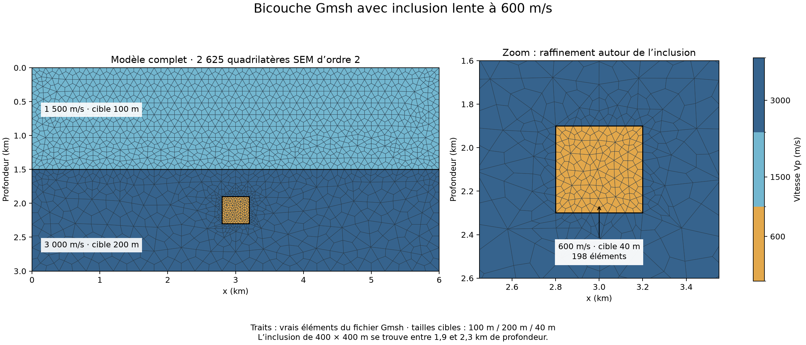

# Bicouche Gmsh avec inclusion à 600 m/s

Analyse des sorties enregistrées du 7 novembre, complétée le 8 novembre 2026.
Les figures représentent les quadrilatères réellement importés par le calcul.



## Géométrie et adaptation spatiale

Domaine de 6 × 3 km. Interface horizontale à 1,5 km de profondeur. Vitesse de
1 500 m/s dans la couche supérieure et 3 000 m/s dans la couche inférieure.
L’inclusion carrée de 400 × 400 m est à 600 m/s, entre x = 2,8 et 3,2 km et
entre 1,9 et 2,3 km de profondeur. Densité uniforme égale à 1.

La taille cible est `vp / (5 Hz × 3 éléments par longueur d’onde)`. Gmsh
construit un maillage conforme par subdivision de triangles en quadrilatères,
avec transition sur 250 m autour du raffinement. Les tailles cibles pilotent
la génération ; elles ne sont pas les longueurs de tous les côtés obtenus.

| Région | Vitesse | Taille cible | Éléments | Médiane de √aire réelle |
|---|---:|---:|---:|---:|
| Couche supérieure | 1 500 m/s | 100 m | 1 662 | 75,89 m |
| Couche inférieure, hors inclusion | 3 000 m/s | 200 m | 765 | 100,77 m |
| Inclusion | 600 m/s | 40 m | 198 | 28,14 m |

Total : **2 625 quadrilatères**, **10 643 nœuds GLL** à l’ordre SEM 2.
Le lecteur reconstruit les nœuds GLL depuis les sommets Q4 du fichier MSH 2.2
ASCII. Les récepteurs sont interpolés dans les éléments à leurs positions
physiques. La qualité minimale Gmsh `minSICN` enregistrée est 0,3014.

## Calcul et comparaison temporelle

Surface libre à pression nulle ; côtés et fond absorbants du premier ordre.
Excitation initiale gaussienne antisymétrisée par rapport à la surface,
centrée à x = 2,2 km et à 200 m de profondeur, écart-type 160 m, sans source
temporelle forcée. 51 récepteurs à 50 m de profondeur, de x = 0,5 à 5,5 km.
Durée physique : 3,6 s.

Les mesures enregistrées utilisent Kokkos Serial, deux échauffements et sept
répétitions dans un ordre mélangé. Les médianes excluent préparation, sorties,
diagnostics et copies host. L’affinité CPU et les caractéristiques matérielles
de cette exécution ne sont pas conservées dans `protocol.json`.

| Intégration | Pas | Boucle médiane | Erreur finale L² massique |
|---|---:|---:|---:|
| Global petit pas | 0,8152 ms | 1 371,56 ms | 0,02783 % |
| Global grand pas | 1,6304 ms | 697,64 ms | 0,11084 % |
| Local | 1,6304 / 0,8152 ms | 884,10 ms | 0,11052 % |

La référence emploie le même maillage et un pas de 0,2038 ms, avec récurrence
temporelle float64 et forces spatiales float32. L’écart entre cette référence
et celle au pas double est 0,00542 %. Cette comparaison mesure l’erreur
temporelle sur un maillage commun, pas l’erreur spatiale.

**Le local coûte 26,73 % de plus que le global au même grand pas**, avec une
erreur finale presque identique. Il économise 35,54 % face au global au petit
pas, mais ce dernier est environ quatre fois plus précis. Le grand pas retenu
reste inférieur à la limite globale estimée de 1,8202 ms. Il n’y a donc pas
d’avantage de performance/précision démontré dans cette configuration.

101 éléments sont au niveau temporel fin (3,85 %) ; leur support spatial
contient 241 éléments (9,18 %). Ces 101 éléments sont dans le matériau à
3 000 m/s. **Le raffinement spatial de l’inclusion lente et la partition
temporelle fine ne coïncident pas** : le pas dépend aussi de la vitesse et des
espacements GLL. Aucun élément de l’inclusion à 600 m/s n’est au petit pas.

L’erreur L² des sismogrammes sans gain est 0,1683 %. Le défaut maximal du
bilan énergie plus dissipation est 4,94 × 10⁻⁶ ; il reste 21,84 % de l’énergie
initiale à la fin. L’erreur massique maximale du champ sur la trajectoire est
0,1107 %. Le script vérifie ces valeurs et la cohérence des statistiques
brutes. Les 91 tests CPU existants de partition, LTS, SEM 2D et lecteur Gmsh
ont été relancés avec succès le 8 novembre, à partir des exécutables existants.

La suite de l’étude consiste à tester des grands pas au-delà de la limite
globale estimée, vérifier la stabilité locale, puis comparer les meilleurs
pas global et local à budget d’erreur fixé. Ce balayage reste à effectuer.

## Figures et reproduction

- [Maillage et partition temporelle](01_maillage_et_partition.png)
- [Propagation](02_propagation.png)
- [Sismogrammes](03_sismogrammes.png)
- [Traces](04_traces.png)
- [Précision, coût et dissipation](05_precision_et_cout.png)
- [Métriques et tailles mesurées](analysis.json)

Les sismogrammes et traces affichent le gain commun
`min((t / 1 s)², 20)` pour le local, la référence et leur différence ; les
trois sismogrammes partagent aussi une seule échelle de couleurs. Les métriques
restent calculées sans gain.

Depuis la racine du worktree, pour vérifier les CSV et refaire les figures :

```bash
../FUnTiDES-install/tpl-venv/bin/python \
  src/solver/impl/sem-local-time-step-2d/validation/plot_gmsh_bilayer.py
```

Pour régénérer le maillage et relancer le calcul, après construction de la
cible `sem2d_gmsh_benchmark` dans la configuration CPU :

```bash
../FUnTiDES-install/tpl-venv/bin/python \
  src/solver/impl/sem-local-time-step-2d/validation/generate_gmsh_bilayer_unstructured.py
env -u LD_LIBRARY_PATH taskset -c 0 \
  build-lts-cpu/src/solver/impl/sem-local-time-step-2d/sem2d_gmsh_benchmark \
  src/solver/impl/sem-local-time-step-2d/validation/gmsh-bilayer-results/bilayer.msh \
  src/solver/impl/sem-local-time-step-2d/validation/gmsh-bilayer-results/materials.csv \
  src/solver/impl/sem-local-time-step-2d/validation/gmsh-bilayer-results 7
```

Ces dernières commandes remplacent les données existantes. Le générateur
nécessite Gmsh 4.15.2, fixé dans `../requirements-gmsh.txt`. La reconstruction
CPU nécessite de restaurer le préfixe Kokkos temporaire décrit dans le
[README du composant](../../README.md) s’il a été supprimé.
