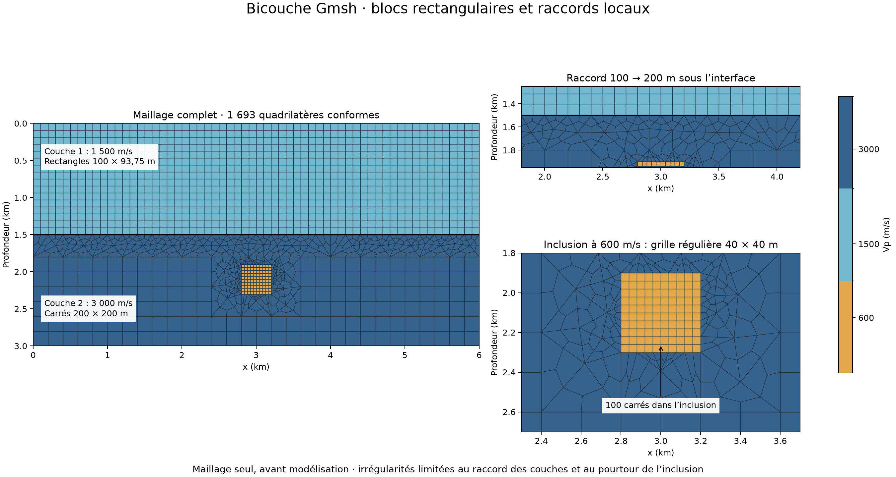
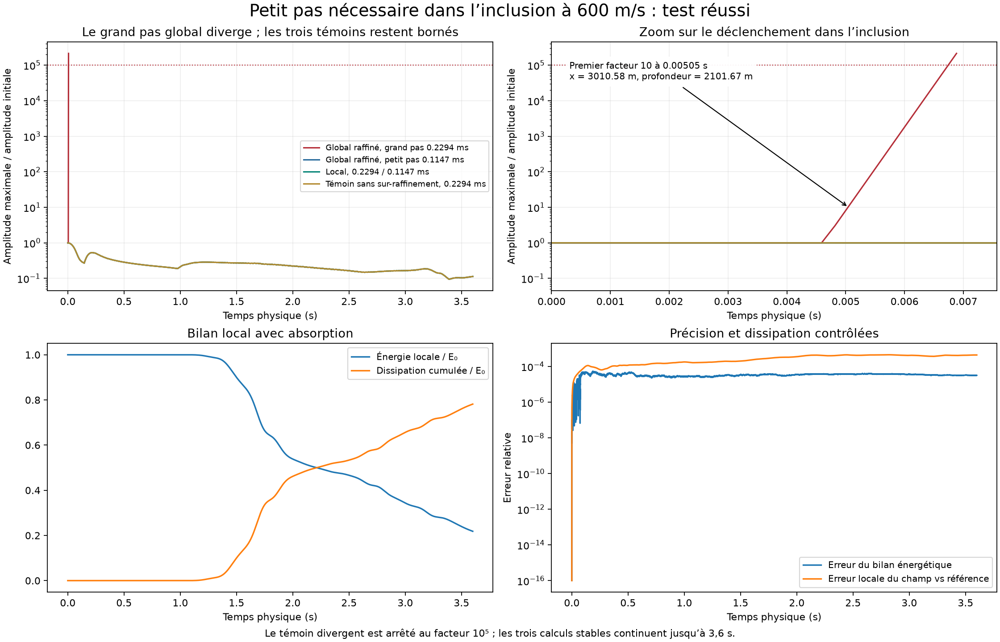
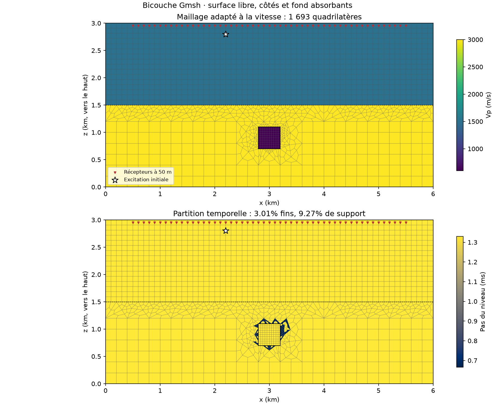
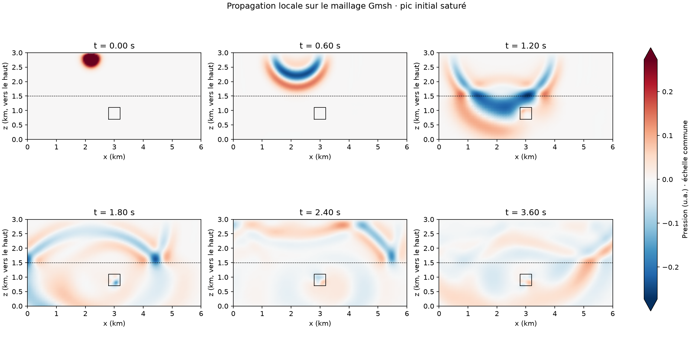
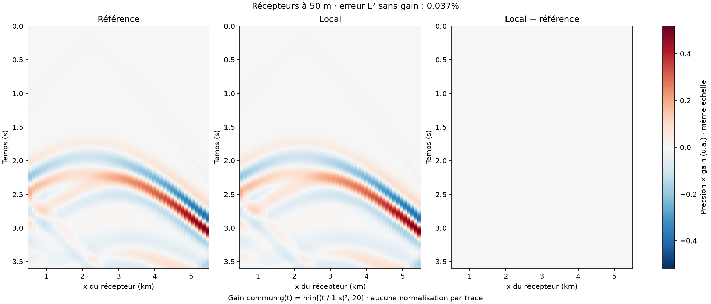
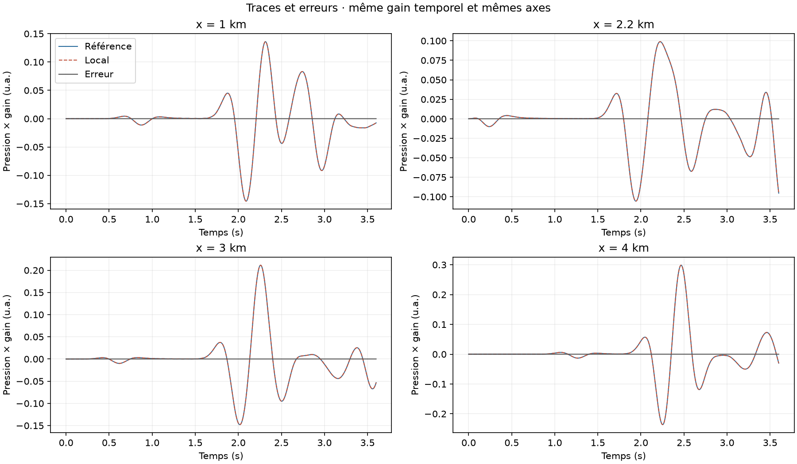
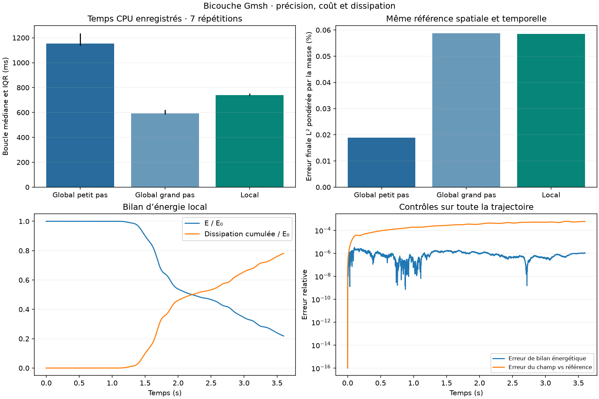

# Maillage bicouche à blocs rectangulaires

Maillage préparé et calculs exécutés le 8 novembre 2026. Il remplace la
génération entièrement non structurée pour la suite de l’étude. Les anciennes
sorties de propagation dans `../gmsh-bilayer-results/` concernent l’ancien
maillage ; elles ne s’appliquent pas à celui-ci.



| Région | Vp | Mailles régulières hors raccords |
|---|---:|---:|
| Couche supérieure | 1 500 m/s | 100 × 93,75 m |
| Couche inférieure | 3 000 m/s | 200 × 200 m |
| Inclusion de 400 × 400 m | 600 m/s | 40 × 40 m, 100 carrés |

La grille supérieure comporte 60 colonnes et 16 rangées pour remplir exactement
6 000 × 1 500 m. La zone de raccord des couches occupe les 300 m immédiatement
sous l’interface, entre 1,5 et 1,8 km de profondeur. Le raccord de l’inclusion
est limité au rectangle x = 2,4–3,6 km, profondeur = 1,8–2,6 km, hors inclusion.
Les quadrilatères des raccords sont irréguliers ; les autres blocs sont réguliers.

Le maillage contient **1 693 quadrilatères**, dont 1 216 rectangles dans les
blocs réguliers et 477 quadrilatères dans les raccords. La qualité minimale
Gmsh `minSICN` est 0,2575. La conformité et les aires sont contrôlées sur le
fichier MSH exporté : aucun bord intérieur sans voisin, aire totale de
18 000 000 m². Le lecteur C++ accepte le maillage et reconstruit 6 911 nœuds
GLL à l’ordre 2. Les contrôles de génération dans `mesh_checks.json` décrivent
uniquement l’inspection du maillage, avant la propagation ci-dessous.

## Modélisation sur le nouveau maillage

Les trois intégrations ont terminé les **3,6 s de temps physique** sans valeurs
non finies. Le sommet est à pression nulle, les côtés et le fond sont absorbants.
L’excitation est un champ initial gaussien antisymétrisé par rapport à la
surface, centré en x = 2,2 km et à 200 m de profondeur, avec un écart-type de
160 m et une dérivée temporelle initiale nulle. Il n’y a pas de source forcée
pendant la propagation. Les 51 récepteurs sont à 50 m de profondeur.

| Intégration | Pas temporel | Pas effectués | Boucle médiane | Erreur finale L² massique |
|---|---:|---:|---:|---:|
| Global petit pas | 0,66519 ms | 5 412 | 1 152,45 ms | 0,01893 % |
| Global grand pas | 1,33038 ms | 2 706 | 593,97 ms | 0,05871 % |
| Local | 1,33038 / 0,66519 ms | 2 706 grands pas | 738,86 ms | 0,05849 % |

Référence commune : même maillage, pas de 0,16630 ms, récurrence temporelle
float64 et forces spatiales float32. L’écart avec la référence au pas double
est de **0,002763 %**. Ces erreurs concernent l’intégration temporelle sur
un même maillage ; l’erreur spatiale n’est pas évaluée ici.

Contrôles réussis : pression exactement nulle au sommet dans les instantanés,
champs et sismogrammes finis, dissipation cumulée croissante, défaut maximal
du bilan énergie plus dissipation de **3,24 × 10⁻⁶**. L’erreur massique maximale
du champ sur la trajectoire est 0,06144 %. L’erreur L² des sismogrammes sans
gain est **0,03677 %**. Il reste 21,85 % de l’énergie initiale en fin de calcul.
Les **91 tests CPU existants** de partition, LTS, SEM 2D et lecteur Gmsh sont
également réussis (`unit_tests.log`).

51 éléments sont au niveau temporel fin (3,01 %), tous dans le matériau à
3 000 m/s. Leur support couvre 157 éléments (9,27 %). Le raffinement spatial
de l’inclusion lente ne nécessite pas ici de la classer au niveau temporel fin.

Les chronométrages CPU utilisent Kokkos Serial, Release GCC 12.3, un cœur fixé
au processeur logique 0 de l’Intel Core i9-13900HX : deux échauffements puis
sept répétitions mélangées. Ils excluent initialisation, diagnostics, copies
host et écritures. Les configurations, empreintes du maillage et du binaire
sont dans `run_environment.json`, les mesures brutes dans `timing_samples.csv`.

**Le local reste 24,39 % plus lent que le global au même grand pas**, avec
une erreur finale presque identique. Son économie de 35,89 % face au global
au petit pas s’accompagne d’une erreur supérieure : ce test ne démontre pas
de gain du LTS à précision comparable.

L’estimation de la limite globale est de 1,5324 ms. L’itération de puissance
atteint son plafond de 2 500 itérations, avec un résidu relatif de
1,36 × 10⁻⁴, au-dessus du seuil demandé de 10⁻⁵. Cette estimation est
explicitement signalée comme non convergée dans `analysis.json` ; elle n’est
pas une borne certifiée. La stabilité observée se limite à ce calcul de 3,6 s
et aux tests effectivement exécutés.

### Test exécuté : petit pas nécessaire dans l’inclusion

**Statut : réussi le 8 novembre 2026.** Le calcul précédent reste un contrôle
de précision dans un régime où les deux intégrateurs sont stables. La
[définition du nouveau test](../gmsh_inclusion_stability_test.json) impose
explicitement l’échec du global au grand pas et la réussite du local.

Le [cas raffiné a été exécuté](../gmsh-inclusion-stability-results/README.md).
À **ΔT = 0,229446 ms**, le global diverge dans l’inclusion après **6,883 ms**.
Le global à **δt = 0,114723 ms**, le local et le témoin sans raffinement
restent stables sur 3,6 s. Les **144 éléments au petit pas** sont tous dans
l’inclusion à 600 m/s. L’erreur massique finale locale est **0,0441 %**.



Le protocole et les critères ci-dessous sont ceux de cette exécution.

On conserve l’inclusion à **600 m/s**, sa géométrie et les deux couches à
1 500 et 3 000 m/s. Le maillage extérieur et le maillage de l’interface
matérielle de l’inclusion restent identiques. Un raffinement supplémentaire
est placé **strictement à l’intérieur de l’inclusion**, avec un raccord
conforme entièrement dans le matériau à 600 m/s. Cela évite de créer de
nouveaux petits éléments dans la couche rapide voisine.

Raffinement utilisé : un carré central de 20 × 20 m,
x = 2 990–3 010 m et z = 890–910 m (z vers le haut), avec des éléments
de 1 m. Le bord de l’inclusion garde son découpage à 40 m. Les pas ont été
calibrés sur le maillage assemblé puis vérifiés par la propagation. Il s’agit
d’un sur-raffinement volontaire pour isoler le mécanisme temporel ; les
tailles de 40 m du cas précédent ne rendent pas l’inclusion limitante.

Le grand pas ΔT et le petit pas δt = ΔT/2 doivent être choisis de façon à
obtenir, après vérification numérique :

```text
δt < limite globale du maillage avec inclusion raffinée < ΔT
ΔT < limite globale du témoin sans ce raffinement intérieur
```

Les spectres des opérateurs assemblés servent à préparer ce choix. La
propagation doit ensuite confirmer les comportements ; doubler une
estimation géométrique minimale ne suffit pas à définir ΔT. Avec la partition
retenue, tous les éléments au niveau fin doivent être dans l’inclusion.
Les éléments voisins du support de l’opérateur et les nœuds partagés restent
pris en compte pour assurer le couplage conforme.

| Cas | Maillage | Intégration | Résultat exigé |
|---|---|---|---|
| Témoin | Maillage actuel, inclusion à 40 m | Global à ΔT | Stable |
| A | Inclusion raffinée | Global à ΔT | Divergence initiée dans l’inclusion |
| B | Identique à A | Global à δt | Stable et précis |
| C | Identique à A | ΔT hors zone fine, δt dans la zone fine de l’inclusion | Stable et précis |

Les cas A, B et C ont exactement le même champ initial, la même dérivée
temporelle initiale et les mêmes conditions aux limites. Une perturbation
nodale déterministe, d’amplitude relative 10⁻⁶ et de support strictement
intérieur à la zone raffinée, excite les modes locaux potentiellement
instables. On ne dépend ainsi pas de leur seule excitation par les arrondis.
Le démarrage doit utiliser la règle de chaque intégrateur pour représenter
ces mêmes conditions initiales physiques.

**Réussite du test sur 3,6 s :**

- Le témoin, B et C restent finis, sans croissance de l’amplitude maximale
  au-delà de dix fois son maximum initial, et respectent la surface libre.
- A dépasse 10⁵ fois l’amplitude maximale initiale. Au premier dépassement
  du facteur 10, le maximum doit se situer dans l’inclusion ; son instant et
  sa position sont enregistrés. On arrête ce témoin après le seuil de
  divergence, sans continuer jusqu’aux NaN.
- Pour C, le défaut relatif du bilan énergie plus dissipation reste inférieur
  à 10⁻⁴. Le champ final et les sismogrammes présentent chacun moins de 1 %
  d’erreur L² face à une référence globale affinée sur le même maillage.
- B présente aussi moins de 1 % d’erreur massique finale. L’écart entre deux
  références successivement raffinées reste inférieur à 0,1 %.
- Aucun élément au niveau temporel fin n’est extérieur à l’inclusion.

**Si A reste stable, le test est en échec**, même si C fonctionne. Si le
témoin diverge aussi, on n’a pas isolé la contrainte de l’inclusion. Le choix
du raffinement ou des pas doit alors être revu, avec les essais conservés.
Les chronométrages viendront après cette validation ; ils ne décident pas de
sa réussite.

Les sorties sont dans `../gmsh-inclusion-stability-results/`.
Le nouveau maillage a été présenté avant la modélisation.

### Figures du calcul

#### Maillage et partition temporelle



#### Propagation à six instants



#### Sismogrammes local, référence et différence

Les sismogrammes affichent le même gain `min((t / 1 s)², 20)` et la même
échelle pour référence, local et différence. Les erreurs sont calculées sans gain.



#### Traces individuelles



#### Précision, coût et bilan d’énergie



Les [métriques contrôlées](analysis.json) sont disponibles au format JSON.

Pour reproduire ces calculs et les contrôles :

```bash
env -u LD_LIBRARY_PATH taskset -c 0 \
  build-lts-cpu/src/solver/impl/sem-local-time-step-2d/sem2d_gmsh_benchmark \
  src/solver/impl/sem-local-time-step-2d/validation/gmsh-structured-results/bilayer.msh \
  src/solver/impl/sem-local-time-step-2d/validation/gmsh-structured-results/materials.csv \
  src/solver/impl/sem-local-time-step-2d/validation/gmsh-structured-results 7
../FUnTiDES-install/tpl-venv/bin/python \
  src/solver/impl/sem-local-time-step-2d/validation/plot_gmsh_bilayer.py \
  --results src/solver/impl/sem-local-time-step-2d/validation/gmsh-structured-results
```

Ces commandes remplacent les sorties de propagation et leurs figures.

## Construction et inspection du maillage

Le générateur utilise des surfaces transfinies recombinées dans les blocs,
partage leurs courbes avec les raccords, puis applique la subdivision en
quadrilatères. Cette subdivision coupe aussi les rectangles en quatre : les
contraintes transfinies sont donc calculées à deux fois la taille finale.
Voir la [documentation Gmsh](https://gmsh.info/doc/texinfo/#Structured-grids).
Les positions des grands blocs doivent être compatibles avec cette grille
grossière ; le générateur contrôle cet alignement avant construction.

Depuis la racine du worktree :

```bash
../FUnTiDES-install/tpl-venv/bin/python \
  src/solver/impl/sem-local-time-step-2d/validation/generate_gmsh_bilayer.py
../FUnTiDES-install/tpl-venv/bin/python \
  src/solver/impl/sem-local-time-step-2d/validation/plot_gmsh_mesh.py
env -u LD_LIBRARY_PATH \
  build-lts-cpu/src/model/mesh/impl/builder/gmsh/gmsh_sem2d_inspect \
  src/solver/impl/sem-local-time-step-2d/validation/gmsh-structured-results/bilayer.msh \
  src/solver/impl/sem-local-time-step-2d/validation/gmsh-structured-results/materials.csv 2
```

Ces commandes génèrent, affichent et inspectent uniquement le maillage. Les
contrôles sont enregistrés dans `mesh_checks.json`. Le fichier `simulation.txt`
prépare les paramètres d’un futur calcul et ne le déclenche pas.
