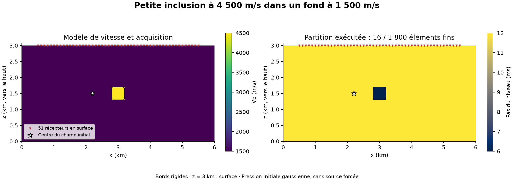
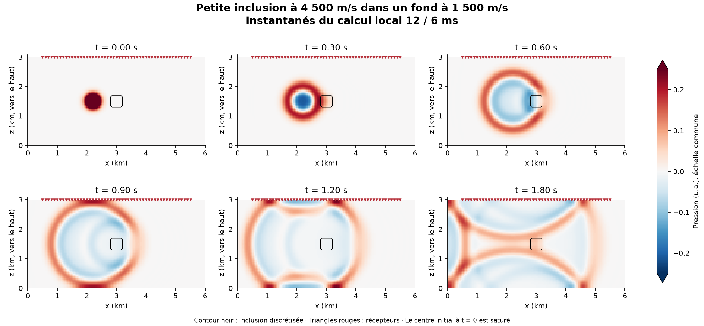
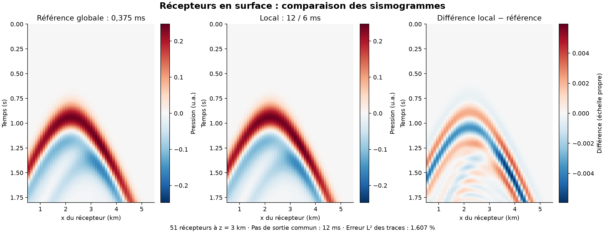
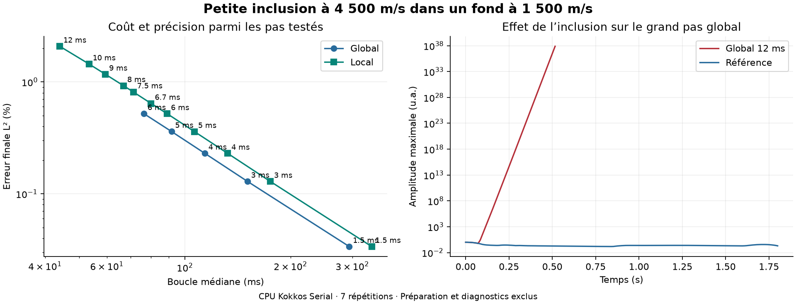

# Petites inclusions rapides : propagation, surface et coût

Calculs du 7 novembre 2026. Le fond est à **1 500 m/s**, l’inclusion carrée
à **4 500 m/s**. Le carré mesure 400 × 400 m dans un domaine de 6 000 × 3 000 m,
soit **16 éléments sur 1 800 (0,89 %)** à l’ordre SEM 2. La densité est constante
et normalisée à 1. Le modèle témoin retire cette inclusion.

La limite de pas global estimée par itération de puissance passe de
**19,246 ms** dans le témoin à **6,579 ms** avec l’inclusion, soit un facteur
2,93. Le grand pas global de 12 ms diverge avec l’inclusion alors que le
local de rapport 2, à 12 / 6 ms, conserve son énergie discrète : dérive relative
maximale de **2,39 × 10⁻⁷** sur 1,8 s. La limite spectrale reste une estimation
numérique, dont le résidu est enregistré dans `spectral.json`.

Les détails mathématiques, les hypothèses et la correspondance avec le code
sont dans le [document technique](../../documentation-mathematique-et-implementation.md).

## Instantanés et récepteurs

La pression initiale est une gaussienne centrée en `(2200, 1500)` m, d’écart-type
160 m et de dérivée temporelle nulle. Il n’y a pas de source forcée. L’axe `z`
pointe vers le haut. Les **51 récepteurs** sont espacés de 100 m entre `x=500`
et `5500` m, au bord supérieur **`z=3000 m`**. Les bords sont rigides, y compris
ce bord d’observation ; il ne s’agit pas d’une surface à pression nulle.



Les six instantanés proviennent du calcul local à 12 / 6 ms. Le contour noir
repère l’inclusion discrétisée ; les triangles rouges sont les récepteurs.
L’échelle est commune et le pic initial est saturé, comme indiqué dans la figure.



La référence utilise le même maillage et un pas global de **0,375 ms**.
L’écart entre références à 0,75 et 0,375 ms est de 0,0201 % sur le champ final.
Les sorties locales et de référence sont prises aux mêmes dates, tous les 12 ms,
sans interpolation temporelle. L’erreur L² relative des traces est de **1,607 %**.



Les [traces individuelles](single_4500/04_traces_surface.png) conservent leurs
amplitudes. Le panneau de différence des sismogrammes possède une échelle propre.

## Coût et précision aux pas testés

| Intégration | Pas | Erreur finale relative L² | Boucle médiane |
|---|---|---:|---:|
| Global | 6 ms | 0,521 % | 76,45 ms |
| Local | 8 / 4 ms | 0,924 % | 66,92 ms |
| Local | 10 / 5 ms | 1,445 % | 53,37 ms |
| Local | 12 / 6 ms | 2,081 % | 44,04 ms |

Au plafond de 2 %, le local à 10 / 5 ms réduit le temps de boucle de **30,2 %**
par rapport au global à 6 ms, pour les pas de cette grille. Les deux erreurs
réalisées diffèrent ; les pas n’ont pas été optimisés continûment. Un global
proche de sa limite estimée, entre 6 et 6,58 ms, reste à mesurer pour préciser
le meilleur compromis. Le local à 12 / 6 ms des figures dépasse légèrement
le plafond de 2 % sur le champ final.

Mesures CPU : Kokkos Serial, GCC 12.3 Release, Intel Core i9-13900HX, affinité
sur le processeur logique 0. Chaque cas est échauffé deux fois puis mesuré sept
fois dans un ordre mélangé. Les quartiles et tous les échantillons sont conservés.
La boucle exclut préparation, diagnostics, copies host et écritures. La fréquence
n’est pas imposée et le cœur n’est pas réservé.



## Plusieurs inclusions et pas indépendants

La [configuration JSON](../inclusion_models.json) contient une liste d’inclusions.
Le cas `multiple_noninteger_targets` ajoute un disque de rayon 220 m, centré en
`(4100, 1900)` m, à 3 600 m/s. Sa discrétisation ajoute 16 éléments rapides.
Les 32 éléments fins ont un support de 72 éléments. Ce cas est calculé et possède
les mêmes cinq figures et fichiers de données dans
[`multiple_noninteger_targets/`](multiple_noninteger_targets/).

Les pas cibles de **12, 4 et 5,5 ms** sont conservés par région et par élément.
Ils ne sont pas arrondis. **Le solveur actuel ne les exécute pas indépendamment** :
les deux inclusions utilisent le même niveau fin du schéma de rapport 2.
Le champ `target_steps_are_executed` est donc `false`. Le document technique
décrit l’architecture d’horloges, d’événements, de couplage et d’observation à
développer pour satisfaire l’exigence de pas non multiples.

## Reproduire

Depuis la racine du worktree et après configuration CPU :

```bash
cmake --build build-lts-cpu --target sem2d_lts_inclusion_benchmark -j 4
../FUnTiDES-install/tpl-venv/bin/python \
  src/solver/impl/sem-local-time-step-2d/validation/prepare_inclusions.py
env -u LD_LIBRARY_PATH taskset -c 0 \
  build-lts-cpu/src/solver/impl/sem-local-time-step-2d/sem2d_lts_inclusion_benchmark \
  src/solver/impl/sem-local-time-step-2d/validation/inclusion-results/single_4500 7
../FUnTiDES-install/tpl-venv/bin/python \
  src/solver/impl/sem-local-time-step-2d/validation/plot_inclusions.py \
  --results src/solver/impl/sem-local-time-step-2d/validation/inclusion-results/single_4500
```

Répéter les deux dernières commandes avec `homogeneous_1500` ou
`multiple_noninteger_targets` pour les autres modèles. Les commandes remplacent
les fichiers du cas correspondant. Les figures sont calculées à partir des CSV
C++ ; Python ne résout pas l’équation d’onde.

Chaque modèle contient `model.csv`, `model.json` et `parameters.txt`, puis
`snapshots.csv`, `receivers.csv`, `history.csv`, `spectral.json`, `diagnostics.json`,
`timing_samples.csv`, `timing_summary.csv`, `protocol.json`, `analysis.json` et
cinq figures. L’environnement et les empreintes des sources de la campagne sont
consignés dans `environment.json` à la racine de ce dossier.

Les 74 tests de régression passent. Les contrôles du binaire et du script de tracé
vérifient les références, l’énergie, les positions de récepteurs, les régions,
les pas cibles, les champs finis et les résumés de temps. Les résultats concernent
l’intégration temporelle sur ce maillage, sans preuve d’erreur spatiale ou de
stabilité pour d’autres configurations.
